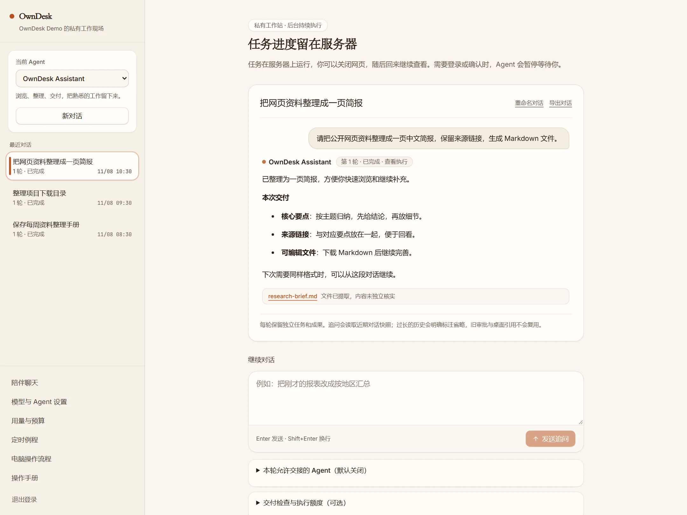
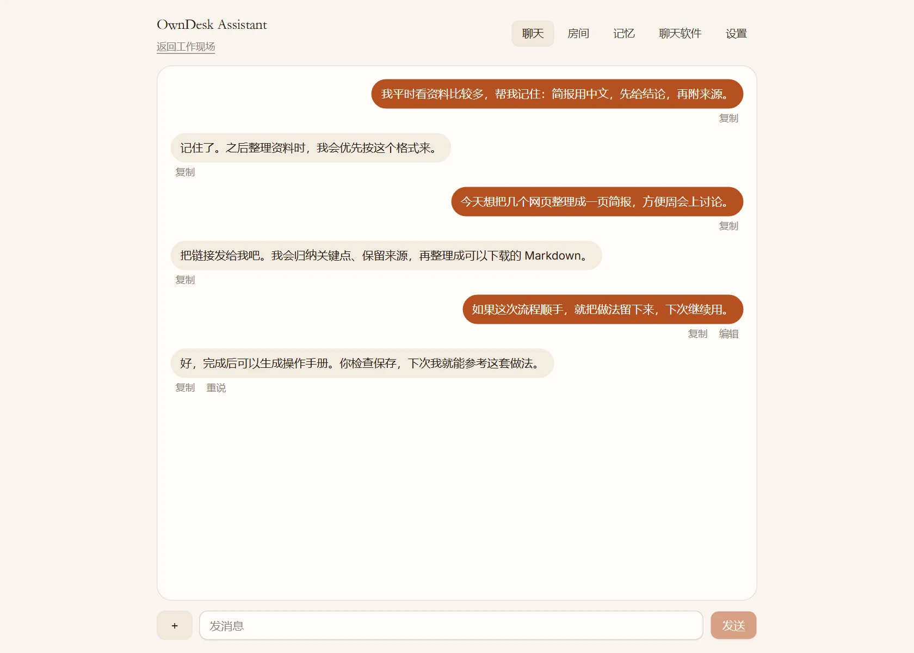
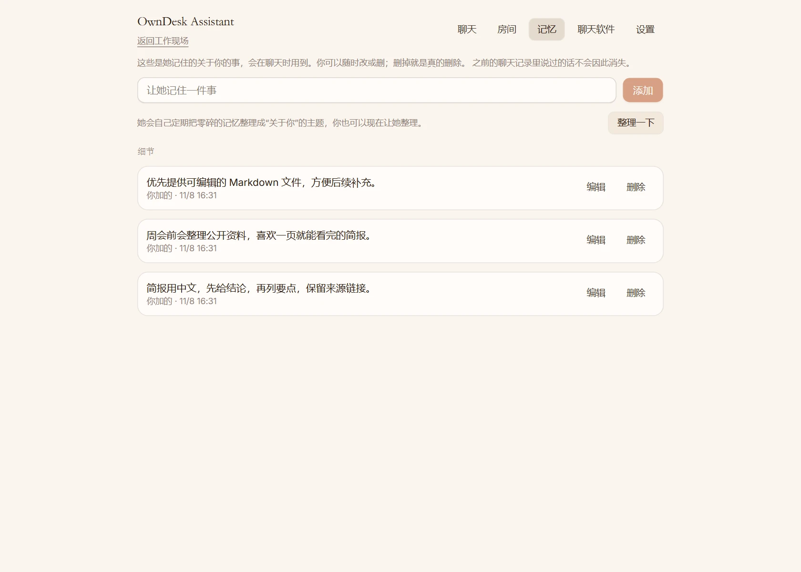
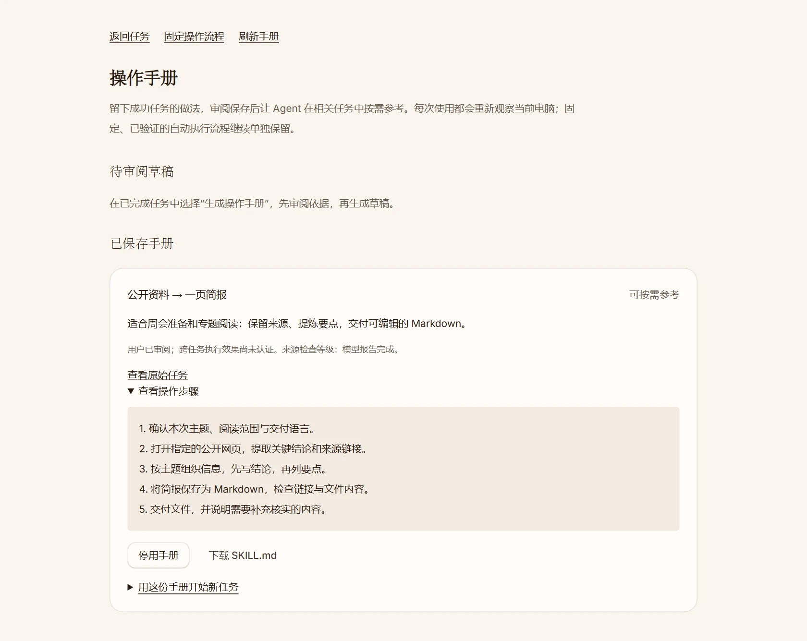
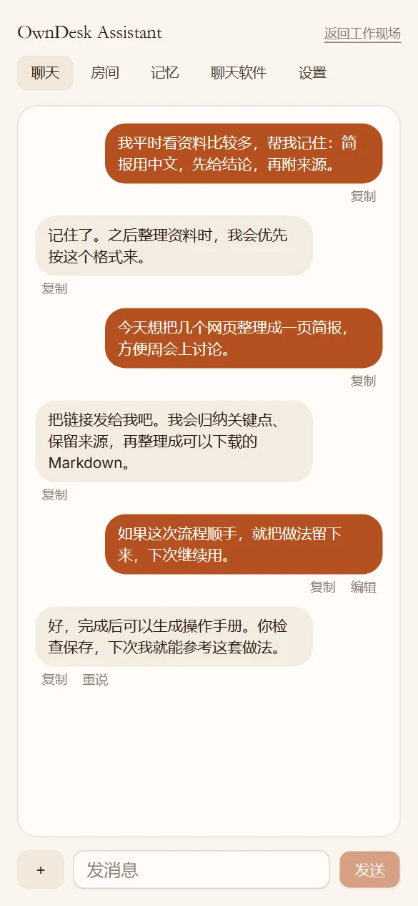
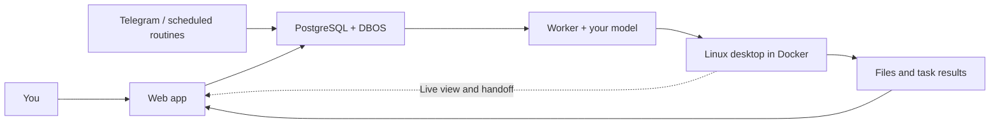

<div align="center">


# OwnDesk

### Your AI. A desk of its own.

Give it a task. Watch it work. Keep the know-how.

A self-hosted personal agent with a real Linux desktop, live human handoff, and reusable operation manuals.

[](LICENSE)
[](#project-status)
[](#quick-start)
[](#bring-your-own-model)

**English** · [简体中文](README.zh-CN.md)

[Quick start](#quick-start) · [Screenshots](#a-look-inside) · [What you can do](#start-with-something-useful) · [Documentation](#documentation)

</div>



OwnDesk gives everyday work a place to happen. Ask it to browse a website, organize files, or prepare a brief. Follow along in its desktop, take over when you need to sign in, and hand control back when you are ready. Turn a successful task into a manual you can review and use again.

## Why OwnDesk

|                                       | What that means for you                                                                                                                           |
| ------------------------------------- | ------------------------------------------------------------------------------------------------------------------------------------------------- |
| **A computer you can see**            | A persistent Linux workspace with Chromium, a file manager, a terminal, and desktop apps. Watch its live screen while a task runs.                |
| **A handoff that feels natural**      | Take over the same desktop for a login or a tricky step. Leave a note, hand it back, and the agent observes the updated screen before continuing. |
| **Work that leaves something useful** | Download the files it produces, revisit the conversation, and ask for a follow-up. Tasks keep their execution records and results.                |
| **Know-how worth keeping**            | Generate an operation manual from a successful task, review its steps, and save it for related work. Export it as `SKILL.md`.                     |
| **A more personal assistant**         | Chat, share images, and keep preferences in editable memory. Review, change, or remove what it remembers.                                         |
| **Your setup, your choice**           | Run on your own machine or server, connect your preferred model, and manage schedules, usage, and budgets in one place.                           |

## Start with something useful

Try these prompts after connecting a model:

| You want to…                  | Ask OwnDesk…                                                                                                                   |
| ----------------------------- | ------------------------------------------------------------------------------------------------------------------------------ |
| **Catch up on a topic**       | “Read this public webpage, summarize three key points, keep the source link, and give me a downloadable `brief.md`.”           |
| **Tidy a workspace**          | “Organize the files in this workstation folder into documents, images, and archives. Keep the filenames and check the result.” |
| **Work through a login**      | “Open this dashboard. Ask me to take over when you reach the login, then continue after I hand it back.”                       |
| **Improve a deliverable**     | “Shorten the brief from our previous task to one page and keep the source links.”                                              |
| **Repeat a familiar process** | “Use my saved research-brief manual to prepare a new brief on this topic.”                                                     |

After a useful task, choose **生成操作手册** (Generate operation manual), review the draft, and save the steps for next time.

## A look inside

Screenshots show the running application’s current Chinese interface with illustrative demo content. [Capture details and sources](docs/README-SHOWCASE.md).

<table>
  <tr>
    <td width="50%" valign="top">
      <strong>Talk it through</strong><br>
      Share context, send an image, and discuss the next task.<br><br>
      <a href="docs/images/companion.webp"></a>
    </td>
    <td width="50%" valign="top">
      <strong>Keep the preferences that matter</strong><br>
      View, edit, and delete the assistant’s saved notes.<br><br>
      <a href="docs/images/memory.webp"></a>
    </td>
  </tr>
</table>

**Make a good workflow easier to repeat.** Saved manuals keep the purpose and steps together, with an export for reuse.



<details>
<summary><strong>On your phone, too</strong></summary>

Open OwnDesk in a mobile browser to chat and manage your assistant. The web app also supports installation to your home screen; see the [notification guide](docs/push.md).

<p align="center">
  
</p>

</details>

## Quick start

### Run locally from source

You will need **Node.js 24.20.0** (see [`.nvmrc`](.nvmrc)), **Docker running Linux containers**, and an **empty PostgreSQL 16 database**. Allow space for a full desktop image; the server guide recommends 4 vCPU, 8 GB RAM, and 40 GB+ SSD. On Windows, WSL2 provides a Linux environment for these services.

**1. Get OwnDesk.**

```sh
git clone https://github.com/wudilyy999/owndesk.git
cd owndesk
npm ci
```

**2. Create your local configuration.** The command below creates `.env` from the template and generates the installation identity and encryption keys. It preserves an existing configuration by refusing to overwrite it.

<details>
<summary>Show configuration command</summary>

```sh
node -e "
const fs = require('node:fs'), c = require('node:crypto');
let text = fs.readFileSync('.env.example', 'utf8');
const values = {
  BETTER_AUTH_SECRET: c.randomBytes(32).toString('hex'),
  MASTER_KEY: c.randomBytes(32).toString('hex'),
  INSTALL_ID: c.randomUUID()
};
for (const [key, value] of Object.entries(values))
  text = text.replace(new RegExp('^' + key + '=.*', 'm'), key + '=' + value);
fs.writeFileSync('.env', text, { flag: 'wx', mode: 0o600 });
"
```

</details>

Edit `.env`: point `DATABASE_URL` at your empty database and keep `APP_URL=http://localhost:6797`. Add your owner account details:

```dotenv
OWNER_EMAIL=you@example.com
OWNER_PASSWORD=replace-with-a-unique-password-of-at-least-12-characters
OWNER_NAME=Owner
OWNER_TIMEZONE=Asia/Shanghai
```

**3. Initialize your account and build the desktop.**

```sh
npm run db:migrate
npm run owner:create
npm run workstation:build
```

After account creation, remove `OWNER_PASSWORD` from `.env` and keep it in your password manager. Keep the installation keys across restarts and upgrades.

**4. Start the worker and the web app in two terminals.**

```sh
# Terminal 1
npm run worker
```

```sh
# Terminal 2
npm run dev
```

**5. Open [localhost:6797](http://localhost:6797).** Sign in, open **模型与 Agent 设置** (Model & Agent settings), configure a provider and default model, then select **新对话** (New conversation) and try a prompt above. In a task’s execution details, you can view the desktop, take control, and download its output.

### Put it on your own server

For an always-on workspace, follow the [self-hosting overview](docs/self-host.md) and [Linux deployment guide](deploy/README.md), including guest networking and the single-owner setup. They cover Compose, HTTPS, and persistent storage. [Cloudflare Tunnel](docs/cloudflare-tunnel.md) provides an access route for machines without a public IP; [backup and recovery](deploy/BACKUP.md) covers an existing installation.

### Bring your own model

Provider integrations include **OpenAI, Anthropic, Google, xAI, DeepSeek, Mistral, Groq, OpenRouter, Ollama, LM Studio**, and **custom OpenAI-compatible endpoints**. Configure the model and credentials through settings. Choose a model with tool calling and image input for desktop tasks.

Task records and workstation files live in your installation. Your selected model provider receives the context needed for a task, which may include text, screenshots, and application controls.

## How it works



The web app handles conversations, settings, and viewing. The worker runs tasks and accesses Docker. The desktop combines browser DOM, screenshots and keyboard/mouse input, plus Linux accessibility controls where available. Its home folder and browser profile persist across tasks.

Model decisions, actions, and results are recorded separately, so the worker can resume from saved progress after a restart. Scheduled routines use the same task queue. A successful task can produce a reviewed manual that a future task loads as guidance.

## Project status

**Alpha, focused on a useful personal agent for one owner.** The current source includes desktop control, handoff, downloadable results, companion chat and memory, chat-to-task continuity with instructions during execution, document and image uploads, scheduled routines, manuals, and a subset of Agent Zero plugin tools. Experimental verified workflows currently cover a limited Thunar directory task family. See [development status](docs/STATUS.md) for validation scope and deployment history.

The [delivery roadmap](docs/DELIVERY-ROADMAP.md) tracks chat continuity, task-time memory retrieval, document uploads, MCP/OAuth app connections, conversational automation, learning from recorded demonstrations, and broader workflow reuse across browser and office apps. Each milestone links its implementation and validation progress.

<details>
<summary><strong>Execution evidence you can inspect</strong></summary>

| Recorded check                                                 | What it established                                                                                                                                                   |
| -------------------------------------------------------------- | --------------------------------------------------------------------------------------------------------------------------------------------------------------------- |
| [Context continuity](docs/evidence/context-continuity.json)    | One real-model desktop task completed with 45 GUI actions and 13 context compressions; files, font settings, and the final window were independently checked.         |
| [Manual generation and reuse](docs/evidence/manuals-live.json) | A real model generated a manual draft, the owner saved it, and a later task loaded it for directory navigation. The report retains the failed missing-directory case. |
| [Native desktop controls](docs/AT-SPI-MIGRATION.md)            | Nine native-control tools and eleven migration requirements were checked, including desktop actions and worker recovery with controlled model responses.              |
| [Workflow packages](docs/WORKFLOW-PACKAGES.md)                 | A bounded Thunar directory workflow was revalidated and reused in an independent installation on the same host, architecture, and image.                              |

These records describe individual scenarios and their limits; screenshots above illustrate the interface. Deployment checks and open work remain in the linked reports.

</details>

## Documentation

Most detailed guides are currently in Chinese.

| Get things done                                                 | Understand and extend                                    |
| --------------------------------------------------------------- | -------------------------------------------------------- |
| [First task](docs/QUICKSTART.md)                                | [Architecture](docs/design/详细设计.md)                  |
| [Operation manuals](docs/MANUALS.md)                            | [Context and memory](docs/CONTEXT.md)                    |
| [Telegram, QQ, and WeChat channels](docs/channels.md)           | [Linux native controls](docs/AT-SPI-MIGRATION.md)        |
| [Mobile notifications](docs/push.md)                            | [Plugin compatibility](docs/AGENT-ZERO-COMPATIBILITY.md) |
| [Self-hosting](docs/self-host.md) · [Upgrades](docs/upgrade.md) | [Workflow packages](docs/WORKFLOW-PACKAGES.md)           |
| [Backup and recovery](deploy/BACKUP.md)                         | [Development setup](docs/DEVELOPMENT-TRANSFER.md)        |

## Contributing

Useful contributions start with a real task: a workflow you want to repeat, a reproducible problem, an integration, or a clearer guide. Open an [issue](https://github.com/wudilyy999/owndesk/issues) with the expected behavior and what happened, or send a focused pull request. For code changes, read [AGENTS.md](AGENTS.md) and include checks relevant to the changed behavior.

If OwnDesk fits how you work, a star helps other people find it.

## License and acknowledgements

OwnDesk is [MIT licensed](LICENSE). It selectively adapts code from Xiryn v0.6.0 and uses MIT-licensed helpers from a0-connector. Upstream copyright notices are preserved; [provenance.json](provenance.json) and [THIRD_PARTY.md](THIRD_PARTY.md) record sources and component licenses.
