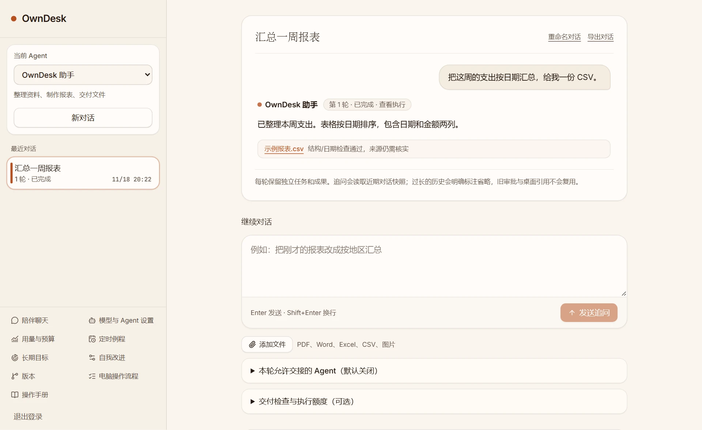
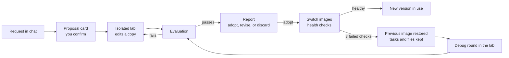
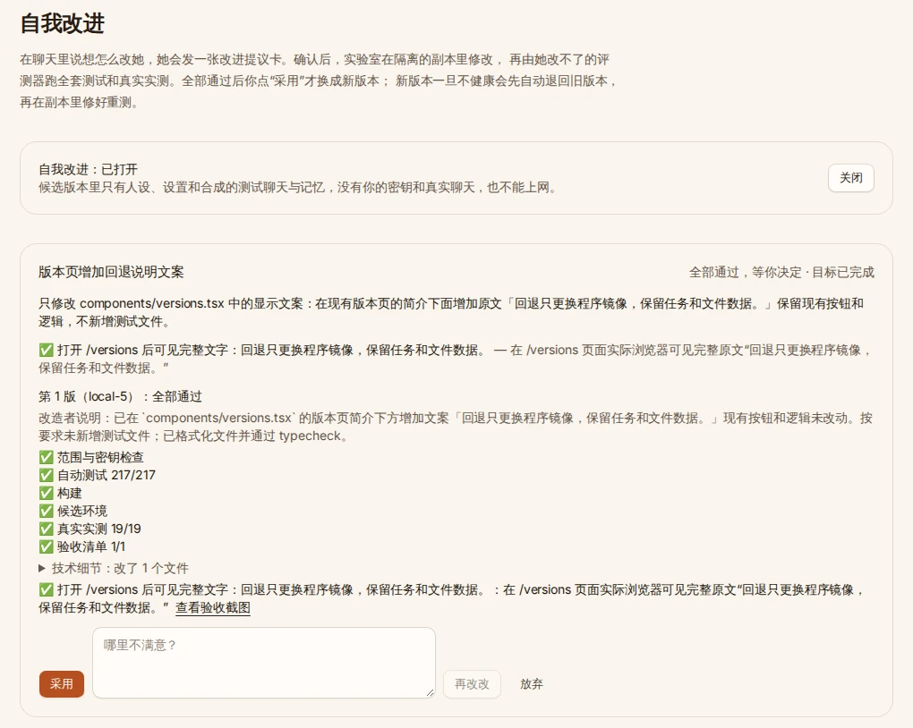
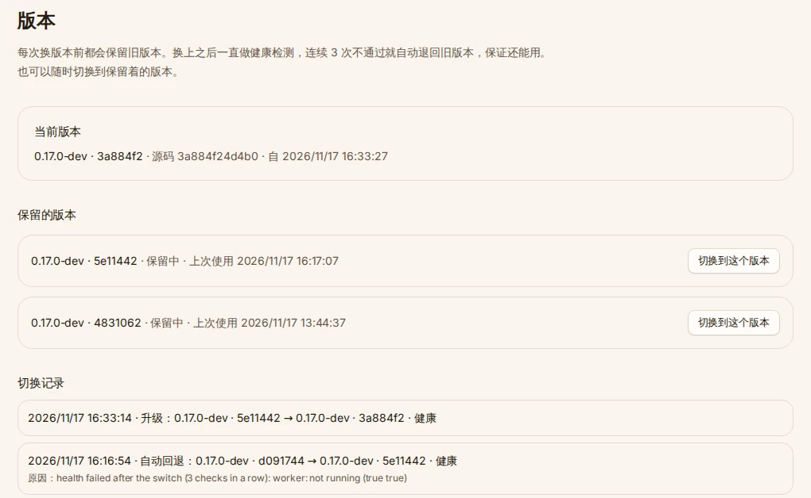
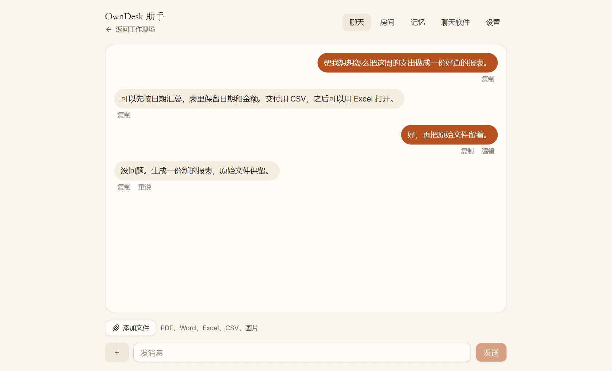
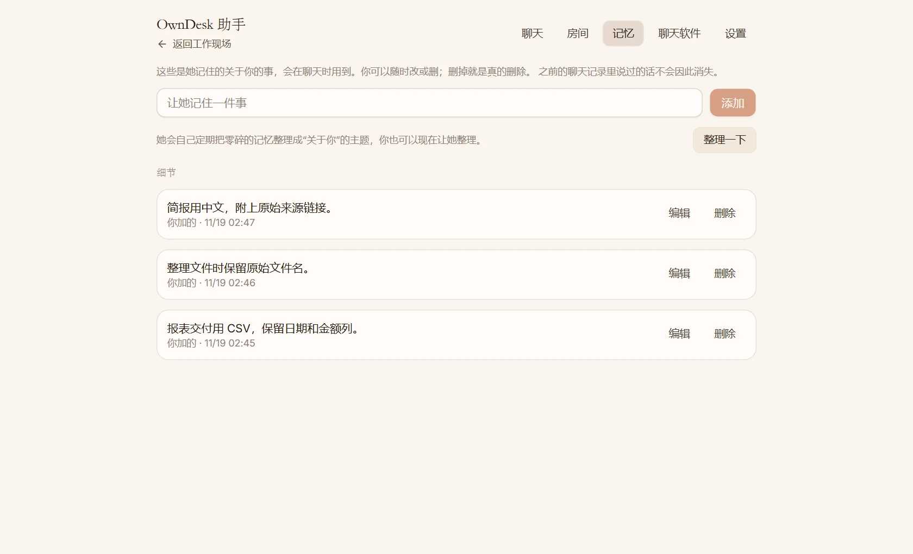
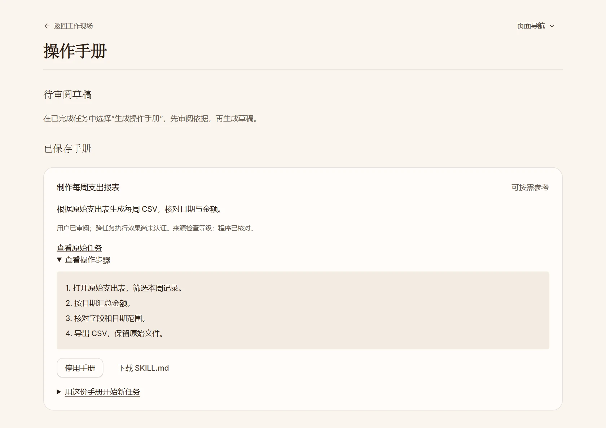
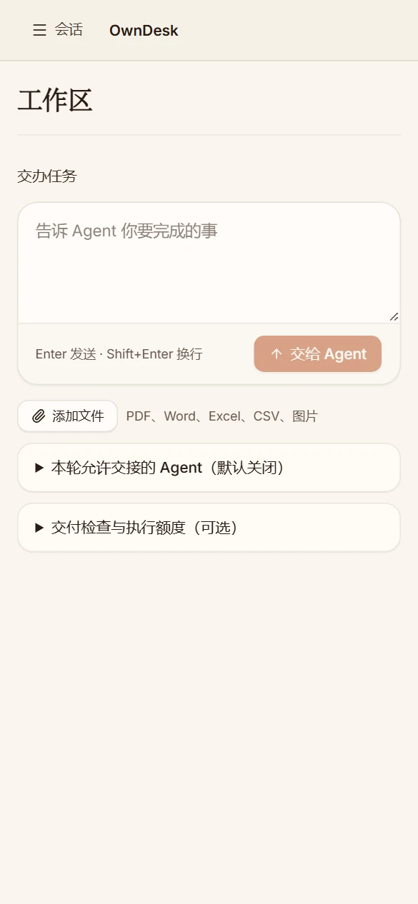
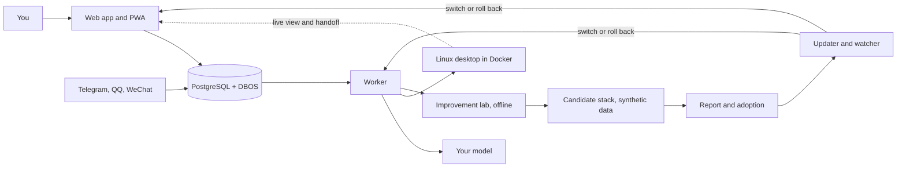
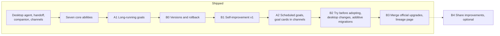

<div align="center">


# OwnDesk

### Your AI. A desk of its own.

A self-hosted personal agent with its own Linux computer.<br>
It chats with you, works on a real desktop, keeps long-running goals moving, and improves itself in an isolated lab.

[](LICENSE)
[](#project-status)
[](#quick-start)
[](#bring-your-own-model)

**English** · [简体中文](README.zh-CN.md)

[Quick start](#quick-start) · [Self-improvement](#self-improvement-with-automatic-rollback) · [Screenshots](#see-it-in-action) · [Roadmap](docs/ROADMAP.md) · [Documentation](#documentation)

</div>



Give OwnDesk a task in plain language. It opens a browser, works with files and desktop apps, and hands back something you can download. You can watch its screen, take over for a login, and hand control back. Bigger goals run in rounds until they are done.

When you want OwnDesk itself to change, describe the change in chat. It builds and tests a new version in an isolated copy, and you decide whether to adopt it. If the new version fails its health checks, OwnDesk switches back to the previous image and keeps your tasks and files.

## Highlights

|                                            | What you get                                                                                                                                                   |
| ------------------------------------------ | -------------------------------------------------------------------------------------------------------------------------------------------------------------- |
| **A computer you can watch and take over** | A persistent Linux desktop with Chromium, a file manager, a terminal, and office apps. Watch the live screen, take control for a login, then hand it back.     |
| **From chat to finished files**            | Agree on a task in chat, attach images or documents, add instructions while it runs, and download the results from the same conversation.                      |
| **Goals that run for days**                | Set a goal such as “fill in three months of expenses.” It works in rounds, reports progress, and stops at your limits or the monthly budget.                   |
| **Self-improvement with rollback**         | Ask for a small feature in chat. A candidate is built and tested in an isolated lab, and you adopt it from a report. A failing version is rolled back for you. |
| **Memory, manuals, and routines**          | Editable memory, reviewed operation manuals (exportable as `SKILL.md`), scheduled and event-triggered routines, MCP apps, and Google Mail and Calendar.        |
| **Your models, your server**               | Bring your own model. Use OwnDesk in the browser, as an installable web app, or through Telegram, QQ, and WeChat adapters.                                     |

## Try these first

After connecting a model, try one of these:

| You want to…                  | Ask OwnDesk…                                                                                                                   |
| ----------------------------- | ------------------------------------------------------------------------------------------------------------------------------ |
| **Catch up on a topic**       | “Read this public webpage, summarize three key points, keep the source link, and give me a downloadable `brief.md`.”           |
| **Tidy a workspace**          | “Organize the files in this workstation folder into documents, images, and archives. Keep the filenames and check the result.” |
| **Work through a login**      | “Open this dashboard. Ask me to take over when you reach the login, then continue after I hand it back.”                       |
| **Keep a goal moving**        | “Build `expenses.csv` for the last three months, one month per round, and stop when all three months are in.”                  |
| **Repeat a familiar process** | “Use my saved research-brief manual to prepare a new brief on this topic.”                                                     |
| **Review a version change**   | “Open the versions page and show me the retained versions and rollback history.”                                               |

After a useful task, choose **生成操作手册** (Generate operation manual), review the draft, and save the steps for next time. Use the sidebar on the workspace or **页面导航** (Page navigation) on settings pages to move between chat, goals, improvements, versions, manuals, and workflows.

## Self-improvement with automatic rollback

Self-improvement is off by default. Turn it on from **自我改进** (Self-improvement, `/improvements`) in the sidebar, then describe the change in chat.



<table>
  <tr>
    <td width="50%" valign="top">
      <strong>Review a tested candidate</strong><br>
      Each check is listed in the report. Adopt, ask for another round, or discard it.<br><br>
      <a href="docs/images/improvement-report.webp"></a>
    </td>
    <td width="50%" valign="top">
      <strong>Switch versions in one click</strong><br>
      Kept versions and every switch, including automatic rollbacks, are on the versions page.<br><br>
      <a href="docs/images/versions.webp"></a>
    </td>
  </tr>
</table>

- **Lab.** The candidate starts from the source bundled in the running image. The lab container has no internet access, no Docker socket, and no environment secrets; model calls go through a metered gateway.
- **Evaluation.** Scope and secret checks, automated tests, image build, a candidate environment with synthetic data and fresh keys, live checks, and your acceptance checklist. The **采用** (Adopt) button appears only after every check passes.
- **Adoption.** The updater keeps the old images, takes a database snapshot, and starts the new version. Health checks run every 10 seconds, and a watcher keeps checking after the switch.
- **Rollback.** Three failed checks in a row bring back the previous web and worker images. The database, uploads, deliverables, and version history stay in place. Running tasks resume from their checkpoints, and pending confirmations remain.
- **Repair.** Once the old version is healthy, a debug round fixes the candidate in the lab. The fix goes through the full evaluation again and waits for you to adopt it.

The first version can change `app/`, `components/`, `lib/`, and `worker/`, and add new tests. Evaluation code, deployment scripts, desktop control, database schema, dependencies, authentication and secrets, budgets, and network controls are protected; a diff is limited to 1,500 lines. Self-improvement and version switching need the [Docker Compose deployment](#deploy-on-a-linux-server). Read the [self-improvement guide](docs/design/self-evolution-manual.md) (Chinese) for the full flow.

## See it in action

Screenshots show the running application’s Chinese interface with illustrative demo content. [Capture details and sources](docs/README-SHOWCASE.md).

<table>
  <tr>
    <td width="50%" valign="top">
      <strong>Talk it through</strong><br>
      Share context, send an image, and discuss the next task.<br><br>
      <a href="docs/images/companion.webp"></a>
    </td>
    <td width="50%" valign="top">
      <strong>Keep the preferences that matter</strong><br>
      View, edit, and delete the assistant’s saved notes.<br><br>
      <a href="docs/images/memory.webp"></a>
    </td>
  </tr>
</table>

**Make a good workflow easier to repeat.** Saved manuals keep the purpose and steps together, with an export for reuse.



<details>
<summary><strong>On your phone, too</strong></summary>

Open OwnDesk in a mobile browser to chat, submit tasks, inspect results, and manage your assistant. The workspace uses a compact drawer on small screens; see the [notification guide](docs/push.md) for installation and notifications.

<p align="center">
  
</p>

</details>

## Quick start

### Run locally from source

You will need **Node.js 24.20.0** (see [`.nvmrc`](.nvmrc)), **Docker running Linux containers**, and an **empty PostgreSQL 16 database**. Allow space for a full desktop image. On Windows, WSL2 provides a Linux environment for these services. A source run covers tasks, chat, goals, and manuals; version switching and self-improvement need the server deployment below.

**1. Get OwnDesk.**

```sh
git clone https://github.com/wudilyy999/owndesk.git
cd owndesk
npm ci
```

**2. Create your local configuration.** The command below creates `.env` from the template and generates the installation identity and encryption keys. It preserves an existing configuration by refusing to overwrite it.

<details>
<summary>Show configuration command</summary>

```sh
node -e "
const fs = require('node:fs'), c = require('node:crypto');
let text = fs.readFileSync('.env.example', 'utf8');
const values = {
  BETTER_AUTH_SECRET: c.randomBytes(32).toString('hex'),
  MASTER_KEY: c.randomBytes(32).toString('hex'),
  INSTALL_ID: c.randomUUID()
};
for (const [key, value] of Object.entries(values))
  text = text.replace(new RegExp('^' + key + '=.*', 'm'), key + '=' + value);
fs.writeFileSync('.env', text, { flag: 'wx', mode: 0o600 });
"
```

</details>

Edit `.env`: point `DATABASE_URL` at your empty database and keep `APP_URL=http://localhost:6797`. Add your owner account details:

```dotenv
OWNER_EMAIL=you@example.com
OWNER_PASSWORD=replace-with-a-unique-password-of-at-least-12-characters
OWNER_NAME=Owner
OWNER_TIMEZONE=Asia/Shanghai
```

**3. Initialize your account and build the desktop.**

```sh
npm run db:migrate
npm run owner:create
npm run workstation:build
```

After account creation, remove `OWNER_PASSWORD` from `.env` and keep it in your password manager. Keep the installation keys across restarts and upgrades.

**4. Start the worker and the web app in two terminals.**

```sh
# Terminal 1
npm run worker
```

```sh
# Terminal 2
npm run dev
```

**5. Open [localhost:6797](http://localhost:6797).** Sign in, open **模型与 Agent 设置** (Model & Agent settings), configure a provider and default model, then select **新对话** (New conversation) and try a prompt above. In a task’s execution details, you can view the desktop, take control, and download its output.

### Deploy on a Linux server

For an always-on assistant with version switching and self-improvement, use Docker Compose on a dedicated Linux host: 4 vCPU, 8 GB RAM, and 40 GB+ SSD, with rootful Docker, Compose v2, iptables, and `br_netfilter`.

Follow sections 2 to 5 of the [Linux deployment guide](deploy/README.md): generate the configuration, build the images, [initialize the guest network](deploy/README.md#4-初始化并核对-guest-网络), and start the database, owner account, and services. The [self-hosting overview](docs/self-host.md) covers HTTPS, including [Cloudflare Tunnel](docs/cloudflare-tunnel.md) for machines without a public IP. [Upgrades and rollback](docs/upgrade.md) and [backup and recovery](deploy/BACKUP.md) cover running installations.

> [!NOTE]
> `scripts/install.sh` currently skips the guest network setup and passes the owner file to `docker compose run` with an unsupported flag. Use the manual steps until it is fixed. No GitHub release or GHCR images are published yet, so images are built from source.

### Bring your own model

Provider integrations include **OpenAI, Anthropic, Google, xAI, DeepSeek, Mistral, Groq, OpenRouter, Ollama, LM Studio**, and **custom OpenAI-compatible endpoints**. Configure the model and credentials in settings. Choose a model with tool calling and image input for desktop tasks.

Task records and workstation files live in your installation. Your selected model provider receives the context needed for a task, which may include text, screenshots, and application controls.

## How it works



The web app handles conversations, settings, and viewing. The worker runs tasks and is the only service with Docker access. The desktop combines browser DOM, screenshots, keyboard and mouse input, and Linux accessibility controls where available. Its home folder and browser profile persist across tasks.

Model decisions, actions, and results are recorded separately, so the worker resumes from saved progress after a restart. Long chats and long tasks work the way Codex and OpenCode do: when the model window fills, older turns are folded into a summary and the recent turns stay word for word, so nothing is cut off at a fixed message count. Routines and goal rounds use the same task queue. Every image carries its own source code, which the lab uses as the starting point for a candidate. The updater runs from the old worker image, so a broken new version cannot block its own rollback.

## Project status

**Alpha, built for one owner on one machine.** Everything below is merged into `main`; the status column shows how far each part has been checked. The latest frontend refresh aligns the workspace, page navigation, mobile layout, and delivery inputs.

| Area                                                          | Status                                                                                |
| ------------------------------------------------------------- | ------------------------------------------------------------------------------------- |
| Desktop tasks, handoff, downloads, manuals                    | Checked with real models; see the evidence below                                      |
| Chat-to-task continuity, memory recall, file uploads          | Merged with database and browser integration tests                                    |
| MCP apps, Google Mail and Calendar                            | Checked with local MCP/OAuth servers and mocked Google responses                      |
| Routines, change watches, webhooks, teaching by demonstration | Merged with integration tests                                                         |
| Cross-app workflows                                           | Limited templates for the browser, Writer, Calc, Mousepad, and Thunar                 |
| Long-running goals                                            | Merged, including a live run with a real model                                        |
| Version switching, automatic rollback, self-improvement       | Merged; real adoption, delayed crash, rollback, repair, and readoption tested locally |
| Telegram                                                      | Tested with a real bot                                                                |
| QQ and WeChat                                                 | Protocol tests against fake services; real platform accounts not yet tested           |
| Web push                                                      | Tested in Chrome; iOS Safari and Firefox not yet tested on devices                    |
| 4 vCPU / 8 GB                                                 | No out-of-memory in tests, but candidate builds come close to the memory limit        |
| Releases                                                      | No GitHub release or GHCR images yet                                                  |



On **Versions**, check for an official update, merge your local changes, or try the official version alone. Each candidate keeps its original request, parent, test results and cost. You can start another improvement from a rejected candidate.

The [roadmap](docs/ROADMAP.md) lists acceptance criteria for each stage, release work, and known gaps. [Development status](docs/STATUS.md) keeps the detailed validation history.

<details>
<summary><strong>Execution evidence you can inspect</strong></summary>

| Recorded check                                                                 | What it established                                                                                                                                                                                                                        |
| ------------------------------------------------------------------------------ | ------------------------------------------------------------------------------------------------------------------------------------------------------------------------------------------------------------------------------------------ |
| [Context continuity](docs/evidence/context-continuity.json)                    | One real-model desktop task completed with 45 GUI actions and 13 context compressions; files, font settings, and the final window were independently checked.                                                                              |
| [Manual generation and reuse](docs/evidence/manuals-live.json)                 | A real model generated a manual draft, the owner saved it, and a later task loaded it for directory navigation. The report retains the failed missing-directory case.                                                                      |
| [Native desktop controls](docs/AT-SPI-MIGRATION.md)                            | Nine native-control tools and eleven migration requirements were checked, including desktop actions and worker recovery with controlled model responses.                                                                                   |
| [Workflow packages](docs/WORKFLOW-PACKAGES.md)                                 | A bounded Thunar directory workflow was revalidated and reused in an independent installation on the same host, architecture, and image.                                                                                                   |
| [Self-improvement and rollback](https://github.com/wudilyy999/owndesk/pull/25) | A candidate crashing after startup was rolled back in about 22 seconds, repaired by a real model, retested, and adopted again. A separate rollback kept four files byte-identical, resumed a running task, and kept pending confirmations. |

These records describe individual scenarios and their limits; screenshots illustrate the interface.

</details>

## Documentation

Most detailed guides are currently in Chinese.

| Use OwnDesk                                                        | Run it                                         | Build on it                                                                      |
| ------------------------------------------------------------------ | ---------------------------------------------- | -------------------------------------------------------------------------------- |
| [First task](docs/QUICKSTART.md)                                   | [Self-hosting](docs/self-host.md)              | [Architecture](docs/design/详细设计.md)                                          |
| [Operation manuals](docs/MANUALS.md)                               | [Linux deployment](deploy/README.md)           | [Goals and self-improvement design](docs/design/goal-and-self-evolution-plan.md) |
| [Goals and self-improvement](docs/design/self-evolution-manual.md) | [Upgrades and rollback](docs/upgrade.md)       | [Context and memory](docs/CONTEXT.md)                                            |
| [Telegram, QQ, and WeChat](docs/channels.md)                       | [Backup and recovery](deploy/BACKUP.md)        | [Workflow packages](docs/WORKFLOW-PACKAGES.md)                                   |
| [Mobile notifications](docs/push.md)                               | [Cloudflare Tunnel](docs/cloudflare-tunnel.md) | [Linux native controls](docs/AT-SPI-MIGRATION.md)                                |
| [Roadmap](docs/ROADMAP.md)                                         | [Development status](docs/STATUS.md)           | [Development setup](docs/DEVELOPMENT-TRANSFER.md)                                |

<details>
<summary><strong>FAQ</strong></summary>

**Does a rollback lose data?** A rollback swaps only the web and worker images. The database, uploads, deliverables, and version history stay as they are, including anything created after the switch. Database snapshots from each switch are kept for manual restores; see [upgrades](docs/upgrade.md).

**What can self-improvement change?** Interface, chat behavior, companion features, notifications, and routines in `app/`, `components/`, `lib/`, and `worker/`. Workstation adapter changes run on an isolated desktop. A candidate can add tables or nullable columns; installing dependencies and changing existing migrations remain restricted. Try the candidate on synthetic data before adopting it.

**Can I run it on Windows or macOS?** A source run works through WSL2 or Docker Desktop. The server deployment, with version switching and self-improvement, needs a Linux host with rootful Docker.

**Which model should I use?** Any configured provider works for chat. Desktop tasks need tool calling and image input. Local models run through Ollama or LM Studio.

</details>

## Contributing

Useful contributions start with a real task: a workflow you want to repeat, a reproducible problem, an integration, or a clearer guide. Open an [issue](https://github.com/wudilyy999/owndesk/issues) with the expected behavior and what happened, or send a focused pull request. For code changes, read [AGENTS.md](AGENTS.md) and include checks relevant to the changed behavior.

If OwnDesk fits how you work, a star helps other people find it.

## License and acknowledgements

OwnDesk is [MIT licensed](LICENSE). It selectively adapts code from Xiryn v0.6.0 and uses MIT-licensed helpers from a0-connector. Upstream copyright notices are preserved; [provenance.json](provenance.json) and [THIRD_PARTY.md](THIRD_PARTY.md) record sources and component licenses.
