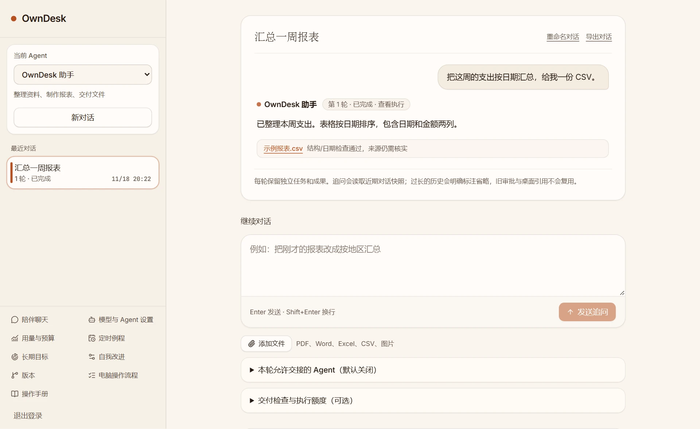
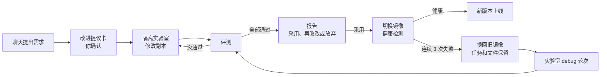
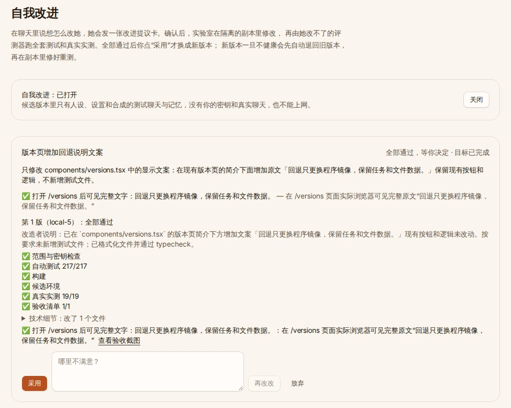
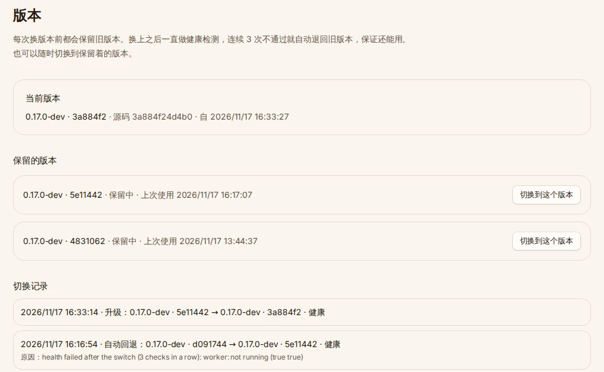
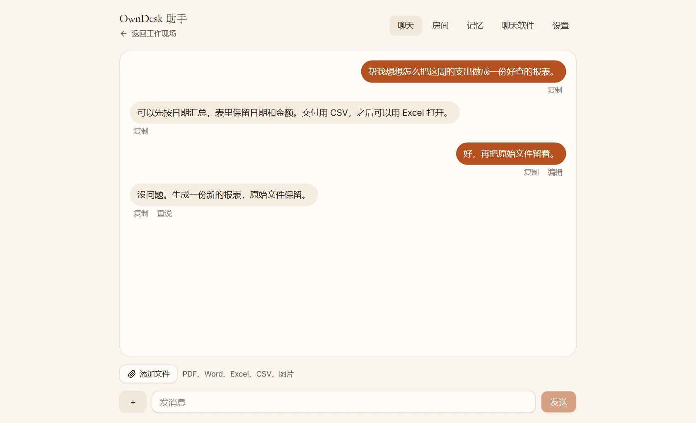
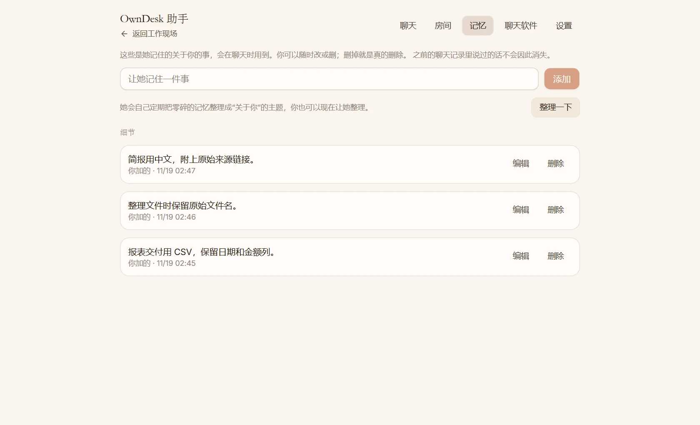
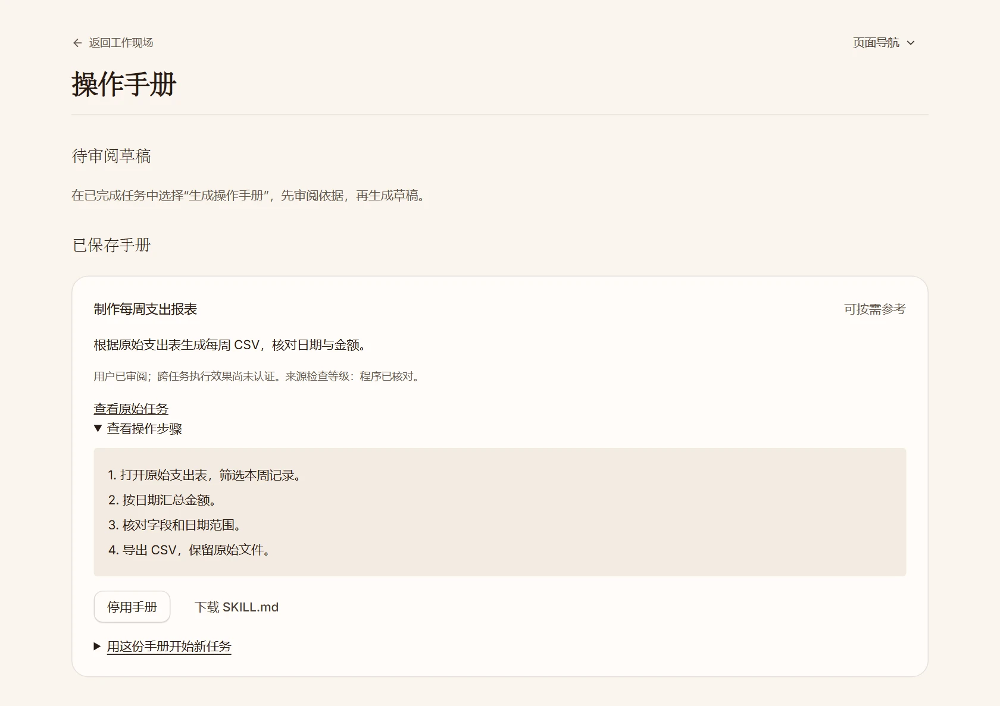
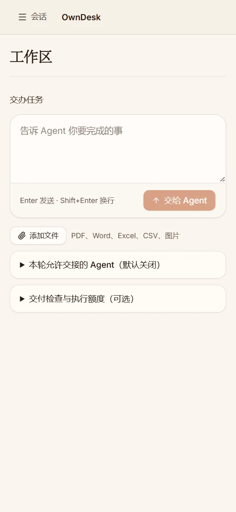
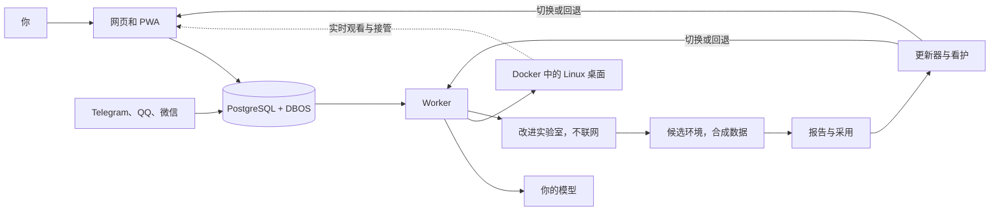
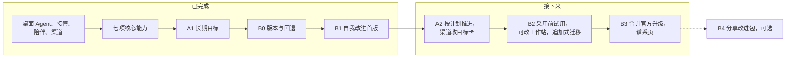

<div align="center">


# OwnDesk

### 你的 AI，有自己的电脑。

自托管的个人 Agent，自带一台 Linux 电脑。<br>
它陪你聊天，在真实桌面上办事，推进长期目标，还能在隔离实验室里改进自己。

[](LICENSE)
[](#项目进展)
[](#开始使用)
[](#选择你喜欢的模型)

[English](README.md) · **简体中文**

[开始使用](#开始使用) · [自我改进](#自我改进与自动回退) · [界面预览](#看看实际界面) · [路线图](docs/ROADMAP.md) · [文档](#文档)

</div>



用大白话把任务交给 OwnDesk。它会打开浏览器、处理文件、使用桌面应用，最后交给你可以下载的成果。执行过程中你可以看它的屏幕，遇到登录时接手，处理完再交还。大一点的目标会分成多轮推进，直到完成。

想让 OwnDesk 自己多一个功能时，在聊天里说出来。它会在隔离副本里做出新版本并完成测试，由你决定是否采用。新版本健康检查不过关时，系统会自动换回上一版镜像，任务和文件都会保留。

## 主要能力

|                            | 你能得到什么                                                                                               |
| -------------------------- | ---------------------------------------------------------------------------------------------------------- |
| **看得见、能接手的电脑**   | 持续保留的 Linux 桌面，带 Chromium、文件管理器、终端和办公软件。可以看实时画面，登录时接手，完成后交还。   |
| **从聊天到交付文件**       | 在聊天里商量好任务，附上图片或文档，执行中随时补充要求，成果在原对话里下载。                               |
| **跨天推进的长期目标**     | 例如“补齐三个月的记账表”。它按轮次推进并汇报进度，到你设的上限或月预算时停下。                             |
| **能自动回退的自我改进**   | 在聊天里提一个小功能。候选版本在隔离实验室里构建和测试，你看报告后再采用；新版出问题会自动换回旧版。       |
| **记忆、手册与例程**       | 可编辑的记忆、经你审阅的操作手册（可导出 `SKILL.md`）、定时与事件触发的例程、MCP 应用、Google 邮箱和日历。 |
| **模型和服务器都由你决定** | 自带模型。可以在网页、安装到手机的网页应用里使用，也可以接 Telegram、QQ 和微信。                           |

## 先试试这些

配置好模型后，可以这样交办：

| 想完成的事             | 发给 OwnDesk 的话                                                              |
| ---------------------- | ------------------------------------------------------------------------------ |
| **快速了解一个主题**   | “读一下这个公开网页，整理三个要点，保留来源链接，生成 `brief.md` 给我下载。”   |
| **整理工作目录**       | “把工作站这个目录中的文件分成资料、图片和归档，保留原文件名，完成后核对结果。” |
| **接着登录后的工作做** | “打开这个控制台，遇到登录先叫我接管；我交还桌面后，你继续处理。”               |
| **推进一个长期目标**   | “做一份最近三个月的 `expenses.csv`，每轮补一个月，三个月都齐了就停。”          |
| **复用熟悉的流程**     | “参考已保存的资料整理手册，按这次主题生成一份新简报。”                         |
| **查看版本变化**       | “打开版本页，看看保留的版本和回退记录。”                                       |

任务完成后，点击 **生成操作手册**，审阅草稿并保存，下次就能照着做。桌面端使用侧栏切换功能，小屏页面使用 **页面导航** 在聊天、目标、改进、版本、手册和流程之间切换。

## 自我改进与自动回退

自我改进默认关闭。在侧栏打开 **自我改进**（`/improvements`）后，直接在聊天里说想改什么。



<table>
  <tr>
    <td width="50%" valign="top">
      <strong>审阅测试过的候选</strong><br>
      报告列出每一项检查结果，可以采用、再改一轮或放弃。<br><br>
      <a href="docs/images/improvement-report.webp"></a>
    </td>
    <td width="50%" valign="top">
      <strong>一键切换版本</strong><br>
      版本页显示保留的版本和每次切换记录，自动回退也会记在这里。<br><br>
      <a href="docs/images/versions.webp"></a>
    </td>
  </tr>
</table>

- **实验室**：候选从当前运行镜像自带的源码开始修改。实验室容器不能联网，不挂 Docker socket，也不带环境变量里的密钥；模型请求经过计费网关。
- **评测**：依次检查改动范围和密钥、自动测试、镜像构建、使用合成数据和全新密钥的候选环境、真实实测，以及你确认的验收清单。全部通过后才会出现 **采用** 按钮。
- **采用**：更新器保留旧镜像，先做数据库快照，再启动新版本。健康检测每 10 秒一次，切换完成后仍有看护容器持续检测。
- **回退**：连续 3 次健康检测失败，系统换回旧的 web 和 worker 镜像。数据库、上传文件、交付成果和版本记录保持原样；运行中的任务从检查点恢复，待确认事项保留。
- **修复**：旧版恢复健康后，实验室开一个 debug 轮次修复候选。修好的版本重新走完整评测，再由你决定是否采用。

第一版只能修改 `app/`、`components/`、`lib/`、`worker/`，以及新增测试。评测代码、部署脚本、桌面控制、数据库结构、依赖、登录和密钥、预算、网络防护都受保护；单次改动不超过 1500 行。自我改进和版本切换需要 [Docker Compose 部署](#部署到-linux-服务器)。完整流程见[自我改进使用手册](docs/design/self-evolution-manual.md)。

## 看看实际界面

以下截图来自实际运行的中文界面，内容使用专门准备的示例数据。[截图来源与采集说明](docs/README-SHOWCASE.md)。

<table>
  <tr>
    <td width="50%" valign="top">
      <strong>先把事情聊清楚</strong><br>
      说明背景、发送图片，讨论接下来要做的事。<br><br>
      <a href="docs/images/companion.webp"></a>
    </td>
    <td width="50%" valign="top">
      <strong>记住重要的偏好</strong><br>
      查看、编辑和删除助手保存的记忆。<br><br>
      <a href="docs/images/memory.webp"></a>
    </td>
  </tr>
</table>

**做过一次，给下次留个起点。** 操作手册把适用场景和步骤放在一起，也可以导出继续使用。



<details>
<summary><strong>手机上也能用</strong></summary>

在手机浏览器中打开 OwnDesk，继续聊天、交办任务、查看结果和管理助手。工作区在小屏幕上使用抽屉式侧栏，网页应用也支持添加到主屏幕，通知配置见[推送指南](docs/push.md)。

<p align="center">
  
</p>

</details>

## 开始使用

### 从源码在本机运行

准备 **Node.js 24.20.0**（见 [`.nvmrc`](.nvmrc)）、**已启动的 Docker Linux 容器环境**和一个**空的 PostgreSQL 16 数据库**。桌面镜像需要一定磁盘空间。Windows 可以通过 WSL2 为这些服务提供 Linux 环境。源码运行可以使用任务、聊天、长期目标和手册；版本切换和自我改进需要下面的服务器部署。

**1. 获取工程。**

```sh
git clone https://github.com/wudilyy999/owndesk.git
cd owndesk
npm ci
```

**2. 创建本地配置。** 下方命令从模板生成 `.env`，并创建安装身份和加密密钥；已有配置会保留，命令拒绝覆盖。

<details>
<summary>展开配置生成命令</summary>

```sh
node -e "
const fs = require('node:fs'), c = require('node:crypto');
let text = fs.readFileSync('.env.example', 'utf8');
const values = {
  BETTER_AUTH_SECRET: c.randomBytes(32).toString('hex'),
  MASTER_KEY: c.randomBytes(32).toString('hex'),
  INSTALL_ID: c.randomUUID()
};
for (const [key, value] of Object.entries(values))
  text = text.replace(new RegExp('^' + key + '=.*', 'm'), key + '=' + value);
fs.writeFileSync('.env', text, { flag: 'wx', mode: 0o600 });
"
```

</details>

编辑 `.env`，将 `DATABASE_URL` 指向刚准备的空数据库，保留 `APP_URL=http://localhost:6797`，再添加自己的账号信息：

```dotenv
OWNER_EMAIL=you@example.com
OWNER_PASSWORD=replace-with-a-unique-password-of-at-least-12-characters
OWNER_NAME=Owner
OWNER_TIMEZONE=Asia/Shanghai
```

**3. 初始化账号，构建桌面。**

```sh
npm run db:migrate
npm run owner:create
npm run workstation:build
```

账号创建成功后，从 `.env` 移除 `OWNER_PASSWORD`，将密码保存在自己的密码管理器中。后续重启和升级继续保留原安装密钥。

**4. 在两个终端分别启动 worker 和网页。**

```sh
# 终端 1
npm run worker
```

```sh
# 终端 2
npm run dev
```

**5. 打开 [localhost:6797](http://localhost:6797)。** 登录后进入 **模型与 Agent 设置**，配置服务商和默认模型。点击 **新对话**，试试上面的任务；在执行详情中可以观看桌面、接管操作和下载成果。

### 部署到 Linux 服务器

想让助手一直在线，并使用版本切换和自我改进，请在一台专用 Linux 主机上用 Docker Compose 部署。建议 4 vCPU、8 GB 内存、40 GB 以上 SSD，需要 rootful Docker、Compose v2、iptables 和 `br_netfilter`。

按 [Linux 部署指南](deploy/README.md) 第 2–5 节操作：生成配置、构建镜像、[初始化 guest 网络](deploy/README.md#4-初始化并核对-guest-网络)，再启动数据库、创建主人账号和启动服务。HTTPS 配置见[自托管概览](docs/self-host.md)，没有公网 IP 时可以用 [Cloudflare Tunnel](docs/cloudflare-tunnel.md)。已有安装的维护见[升级与回退](docs/upgrade.md)和[备份与恢复](deploy/BACKUP.md)。

> [!NOTE]
> `scripts/install.sh` 目前没有初始化 guest 网络，创建主人时还给 `docker compose run` 传了不支持的参数。修复前请按上面的手动步骤部署。项目还没有发布 GitHub Release 和 GHCR 镜像，镜像需要从源码构建。

### 选择你喜欢的模型

已接入 **OpenAI、Anthropic、Google、xAI、DeepSeek、Mistral、Groq、OpenRouter、Ollama、LM Studio** 和 **自定义 OpenAI 兼容端点**。在设置中填写模型与凭据；桌面任务应选择支持工具调用和图像输入的模型。

任务记录和桌面文件保存在自己的安装中。所选模型服务会收到完成任务所需的上下文，其中可能包含文字、截图和应用控件信息。

## 它怎样运行



网页负责对话、设置和观看，worker 负责执行任务，也是唯一能访问 Docker 的服务。桌面结合网页 DOM、截图、键鼠操作，在应用支持时使用 Linux 无障碍控件。主目录和浏览器配置会跨任务保留。

模型决策、工具动作和结果分别记录，worker 重启后可以从已保存的进度恢复。例程和长期目标的每一轮都进入同一条任务队列。每个镜像都自带构建它的源码，实验室从这份源码开始做候选。更新器用旧版 worker 镜像运行，所以新版本坏了也挡不住回退。

## 项目进展

**当前处于 Alpha，面向一个主人、一台机器。** 下表内容都已合并到 `main`，状态一列说明各部分验证到什么程度。最近一次前端整理统一了工作区、页面导航、移动端布局和交付输入。

| 能力                                   | 状态                                                         |
| -------------------------------------- | ------------------------------------------------------------ |
| 桌面任务、接管交还、成果下载、操作手册 | 已用真实模型检查，见下方执行证据                             |
| 聊天到任务的连续性、记忆召回、文件上传 | 已合并，数据库和浏览器集成测试通过                           |
| MCP 应用、Google 邮箱和日历            | 用本地 MCP/OAuth 服务和模拟的 Google 响应测试                |
| 例程、网页变化监听、webhook、示范教学  | 已合并，集成测试通过                                         |
| 跨应用流程                             | 浏览器、Writer、Calc、Mousepad 和 Thunar 的有限模板          |
| 长期目标                               | 已合并，包含一次真实模型多轮实测                             |
| 版本切换、自动回退、自我改进           | 已合并；真实采用、延迟崩溃、回退、修复和再次采用均在本机实测 |
| Telegram                               | 已用真实机器人测试                                           |
| QQ 和微信                              | 用假服务做协议测试，还没有用真实平台账号测试                 |
| 网页推送                               | Chrome 实测；iOS Safari 和 Firefox 还没有真机验证            |
| 4 vCPU / 8 GB                          | 测试中没有内存溢出，但候选构建时接近内存上限                 |
| 发布                                   | 还没有 GitHub Release 和 GHCR 镜像                           |



[路线图](docs/ROADMAP.md)列出每个阶段的验收标准、发布工作和已知缺口。详细验证历史见[开发状态](docs/STATUS.md)。

<details>
<summary><strong>可以查看的执行证据</strong></summary>

| 已记录的检查                                                    | 具体说明了什么                                                                                                                           |
| --------------------------------------------------------------- | ---------------------------------------------------------------------------------------------------------------------------------------- |
| [上下文连续性](docs/evidence/context-continuity.json)           | 一次真实模型桌面任务经过 45 个 GUI 动作和 13 次上下文压缩后完成；文件、字体设置与最终窗口经过独立检查。                                  |
| [手册生成与复用](docs/evidence/manuals-live.json)               | 真实模型生成手册草稿，用户保存后，后续任务主动加载并完成目录导航；报告同时保留目标目录不存在的失败案例。                                 |
| [原生桌面控件](docs/AT-SPI-MIGRATION.md)                        | 检查 9 个原生控件工具与 11 项迁移要求，包括真实桌面动作和使用受控模型响应的 worker 恢复。                                                |
| [流程包](docs/WORKFLOW-PACKAGES.md)                             | 在同宿主、同架构、同镜像的独立安装中，重新验证并复用有限的 Thunar 目录流程。                                                             |
| [自我改进与回退](https://github.com/wudilyy999/owndesk/pull/25) | 启动后崩溃的候选约 22 秒内自动回退，真实模型修复、重测后再次采用。另一次回退中四个文件逐字节相同，运行中的任务恢复完成，待确认事项保留。 |

这些记录对应各自的场景与范围；截图用于展示界面。

</details>

## 文档

| 使用                                                       | 部署与维护                                     | 理解与扩展                                                            |
| ---------------------------------------------------------- | ---------------------------------------------- | --------------------------------------------------------------------- |
| [第一个任务](docs/QUICKSTART.md)                           | [自托管概览](docs/self-host.md)                | [架构设计](docs/design/详细设计.md)                                   |
| [操作手册](docs/MANUALS.md)                                | [Linux 部署](deploy/README.md)                 | [长期目标与自我改进设计](docs/design/goal-and-self-evolution-plan.md) |
| [长期目标与自我改进](docs/design/self-evolution-manual.md) | [升级与回退](docs/upgrade.md)                  | [上下文与记忆](docs/CONTEXT.md)                                       |
| [Telegram、QQ 与微信](docs/channels.md)                    | [备份与恢复](deploy/BACKUP.md)                 | [流程包](docs/WORKFLOW-PACKAGES.md)                                   |
| [手机通知](docs/push.md)                                   | [Cloudflare Tunnel](docs/cloudflare-tunnel.md) | [Linux 原生控件](docs/AT-SPI-MIGRATION.md)                            |
| [路线图](docs/ROADMAP.md)                                  | [开发状态](docs/STATUS.md)                     | [换机开发指南](docs/DEVELOPMENT-TRANSFER.md)                          |

<details>
<summary><strong>常见问题</strong></summary>

**回退会丢数据吗？** 回退只更换 web 和 worker 镜像。数据库、上传文件、交付成果和版本记录保持原样，切换后新增的内容也会保留。每次切换前的数据库快照另外保存，需要时可以手动恢复，见[升级与回退](docs/upgrade.md)。

**自我改进能改什么？** 界面、聊天行为、陪伴功能、通知和例程，范围限于 `app/`、`components/`、`lib/`、`worker/`。修改桌面、数据库结构和依赖安排在 B2 阶段。

**能在 Windows 或 macOS 上跑吗？** 源码运行可以通过 WSL2 或 Docker Desktop。带版本切换和自我改进的服务器部署需要 Linux 主机和 rootful Docker。

**该用什么模型？** 聊天用任意已配置的服务商都可以。桌面任务需要支持工具调用和图像输入的模型。本地模型可以通过 Ollama 或 LM Studio 接入。

</details>

## 一起完善 OwnDesk

欢迎从一个具体任务开始贡献：想重复使用的工作流程、可以复现的问题、应用集成，或一份更易懂的指南。通过 [Issue](https://github.com/wudilyy999/owndesk/issues) 描述预期与实际表现，也可以直接提交聚焦问题的 PR。修改代码前请阅读 [AGENTS.md](AGENTS.md)，并补充与改动相关的检查。

如果 OwnDesk 适合你的工作方式，欢迎点一个 Star，让更多人找到它。

## 许可与致谢

OwnDesk 采用 [MIT 许可](LICENSE)，选择性复用 Xiryn v0.6.0 的代码及 a0-connector 的部分 MIT 辅助函数，保留上游版权声明。[provenance.json](provenance.json) 和 [THIRD_PARTY.md](THIRD_PARTY.md) 记录来源与各组件许可。
