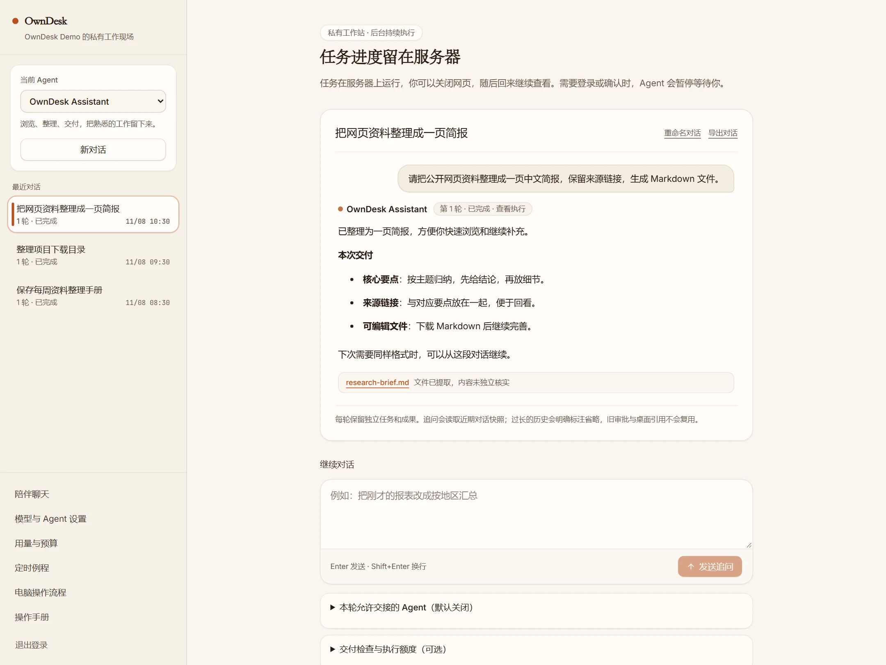
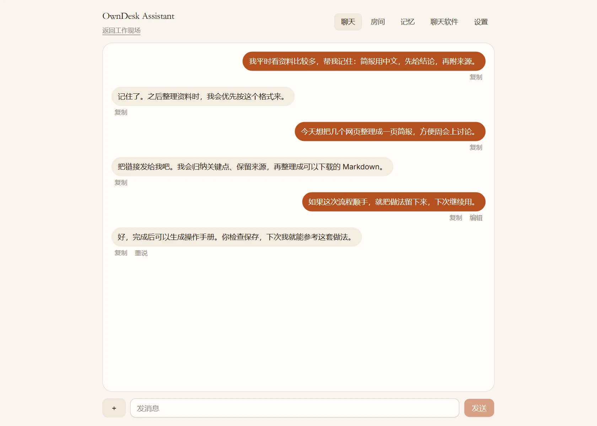
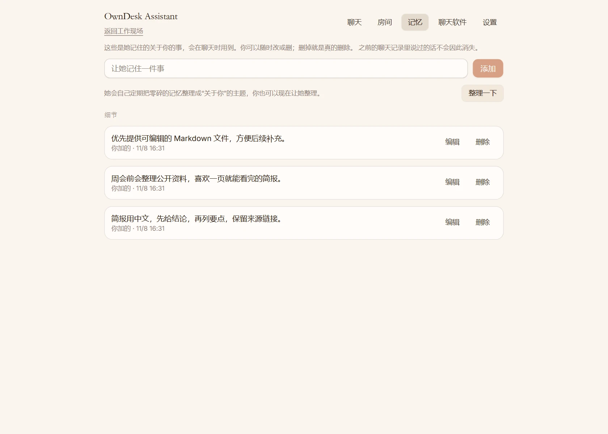
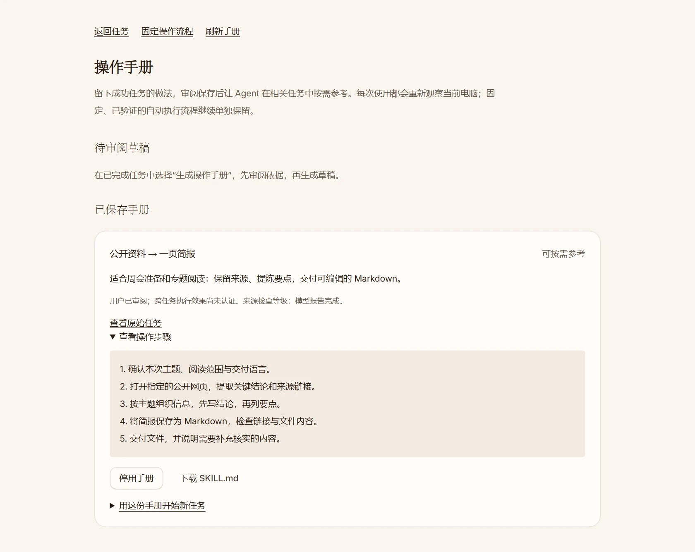
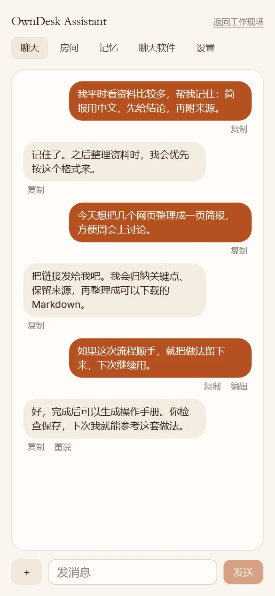
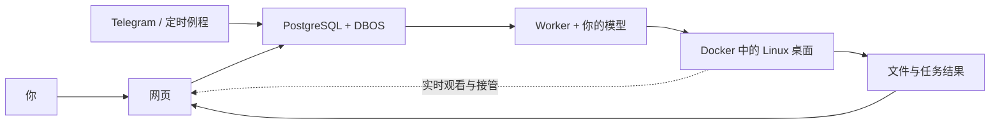

<div align="center">


# OwnDesk

### 你的 AI，有自己的电脑。

把任务交给它，看着它完成，把好用的做法留下来。

自托管的个人 Agent：真实 Linux 桌面、随时接管与交还、可复用的操作手册。

[](LICENSE)
[](#项目进展)
[](#开始使用)
[](#选择你喜欢的模型)

[English](README.md) · **简体中文**

[开始使用](#开始使用) · [界面预览](#看看实际界面) · [能做什么](#从一件有用的小事开始) · [文档](#文档)

</div>



OwnDesk 给日常工作准备了一台专属电脑。你用自然语言交办任务，它在自己的桌面上浏览网页、整理文件、准备简报。你可以观看进度，在需要登录时接手，操作完再交还。一次顺手的任务，还能整理成可审阅的手册，留给下次继续用。

## 为什么用 OwnDesk

|                          | 你能得到什么                                                                                         |
| ------------------------ | ---------------------------------------------------------------------------------------------------- |
| **工作过程看得见**       | 一台持续保留工作区的 Linux 电脑，配有 Chromium、文件管理器、终端和桌面应用；执行时可以观看实时画面。 |
| **需要时，自然接手**     | 在同一台桌面上完成登录或复杂操作，留下说明后交还；Agent 重新观察当前画面，再接着做。                 |
| **完成之后，有东西带走** | 下载交付文件，回看任务过程，在原对话中继续修改；每次任务都保留执行记录和结果。                       |
| **好用的做法，留下来**   | 从成功任务生成操作手册，审阅步骤后保存，后续相关任务按需参考；支持导出 `SKILL.md`。                  |
| **更了解你的工作习惯**   | 日常聊天、发送图片，把偏好保存在可编辑的记忆中；随时查看、修改或删除。                               |
| **部署和模型，自己选**   | 在自己的电脑或服务器运行，接入喜欢的模型，集中管理定时任务、用量和预算。                             |

## 从一件有用的小事开始

配置模型后，可以试着这样交办：

| 想完成的事             | 发给 OwnDesk 的话                                                              |
| ---------------------- | ------------------------------------------------------------------------------ |
| **快速了解一个主题**   | “读一下这个公开网页，整理三个要点，保留来源链接，生成 `brief.md` 给我下载。”   |
| **整理工作目录**       | “把工作站这个目录中的文件分成资料、图片和归档，保留原文件名，完成后核对结果。” |
| **接着登录后的工作做** | “打开这个控制台，遇到登录先叫我接管；我交还桌面后，你继续处理。”               |
| **完善刚才的交付**     | “把上一轮简报压缩成一页，来源链接继续保留。”                                   |
| **复用熟悉的流程**     | “参考已保存的资料整理手册，按这次主题生成一份新简报。”                         |

任务完成后，点击 **生成操作手册**，审阅草稿并保存，就能为下次留下操作步骤。

## 看看实际界面

以下截图采集自实际运行的中文界面，内容使用专门准备的示例数据。[截图来源与采集说明](docs/README-SHOWCASE.md)。

<table>
  <tr>
    <td width="50%" valign="top">
      <strong>先把事情聊清楚</strong><br>
      说明背景、发送图片，讨论接下来要做的事。<br><br>
      <a href="docs/images/companion.webp"></a>
    </td>
    <td width="50%" valign="top">
      <strong>记住重要的偏好</strong><br>
      查看、编辑和删除助手保存的记忆。<br><br>
      <a href="docs/images/memory.webp"></a>
    </td>
  </tr>
</table>

**做过一次，给下次留个起点。** 操作手册把适用场景和步骤放在一起，也可以导出继续使用。



<details>
<summary><strong>手机上也能用</strong></summary>

在手机浏览器中打开 OwnDesk，继续聊天、管理助手。网页应用也支持添加到主屏幕，通知配置见[推送指南](docs/push.md)。

<p align="center">
  
</p>

</details>

## 开始使用

### 从源码在本机运行

准备 **Node.js 24.20.0**（见 [`.nvmrc`](.nvmrc)）、**已启动的 Docker Linux 容器环境**和一个**空的 PostgreSQL 16 数据库**。桌面镜像需要一定磁盘空间；服务器指南建议 4 vCPU、8 GB 内存、40 GB 以上 SSD。Windows 可以通过 WSL2 为这些服务提供 Linux 环境。

**1. 获取工程。**

```sh
git clone https://github.com/wudilyy999/owndesk.git
cd owndesk
npm ci
```

**2. 创建本地配置。** 下方命令从模板生成 `.env`，并创建安装身份和加密密钥；已有配置会保留，命令拒绝覆盖。

<details>
<summary>展开配置生成命令</summary>

```sh
node -e "
const fs = require('node:fs'), c = require('node:crypto');
let text = fs.readFileSync('.env.example', 'utf8');
const values = {
  BETTER_AUTH_SECRET: c.randomBytes(32).toString('hex'),
  MASTER_KEY: c.randomBytes(32).toString('hex'),
  INSTALL_ID: c.randomUUID()
};
for (const [key, value] of Object.entries(values))
  text = text.replace(new RegExp('^' + key + '=.*', 'm'), key + '=' + value);
fs.writeFileSync('.env', text, { flag: 'wx', mode: 0o600 });
"
```

</details>

编辑 `.env`，将 `DATABASE_URL` 指向刚准备的空数据库，保留 `APP_URL=http://localhost:6797`，再添加自己的账号信息：

```dotenv
OWNER_EMAIL=you@example.com
OWNER_PASSWORD=replace-with-a-unique-password-of-at-least-12-characters
OWNER_NAME=Owner
OWNER_TIMEZONE=Asia/Shanghai
```

**3. 初始化账号，构建桌面。**

```sh
npm run db:migrate
npm run owner:create
npm run workstation:build
```

账号创建成功后，从 `.env` 移除 `OWNER_PASSWORD`，将密码保存在自己的密码管理器中。后续重启和升级继续保留原安装密钥。

**4. 在两个终端分别启动 worker 和网页。**

```sh
# 终端 1
npm run worker
```

```sh
# 终端 2
npm run dev
```

**5. 打开 [localhost:6797](http://localhost:6797)。** 登录后进入 **模型与 Agent 设置**，配置服务商和默认模型。点击 **新对话**，试试上面的任务；在执行详情中可以观看桌面、接管操作和下载成果。

### 部署到自己的服务器

希望随时可用，可以从[自托管安装概览](docs/self-host.md)和 [Linux 部署指南](deploy/README.md)开始，完成工作站网络与单主人配置。指南包含 Compose、HTTPS 和持久化存储；没有公网 IP 的设备可以使用 [Cloudflare Tunnel](docs/cloudflare-tunnel.md)，已有安装的迁移见[备份与恢复](deploy/BACKUP.md)。

### 选择你喜欢的模型

已接入 **OpenAI、Anthropic、Google、xAI、DeepSeek、Mistral、Groq、OpenRouter、Ollama、LM Studio** 和 **自定义 OpenAI 兼容端点**。在设置中填写模型与凭据；桌面任务应选择支持工具调用和图像输入的模型。

任务记录和桌面文件保存在自己的安装中。所选模型服务会收到完成任务所需的上下文，其中可能包含文字、截图和应用控件信息。

## 它怎样运行



网页负责对话、设置和观看，worker 负责执行任务并访问 Docker。桌面结合网页 DOM、截图与键鼠操作，在应用支持时使用 Linux 无障碍控件。主目录和浏览器配置会跨任务保留。

模型决策、工具动作和结果分别记录，worker 重启后可以从已保存的进度恢复。定时例程进入同一条任务队列；成功任务可以生成经你审阅的手册，为后续任务提供操作指导。

## 项目进展

**当前处于 Alpha，优先做好一个人日常可用的个人 Agent。** 源码已包含桌面操作、接管交还、成果下载、陪伴聊天与记忆、聊天到任务的上下文延续和执行中补充指令、文档与图片上传、定时例程、操作手册，以及部分 Agent Zero 插件工具兼容。实验性的已验证流程目前覆盖有限的 Thunar 目录任务族。具体验证范围与部署历史见[开发状态](docs/STATUS.md)。

[交付路线图](docs/DELIVERY-ROADMAP.md)记录聊天连续性、办事记忆召回、文档上传、MCP/OAuth 应用连接、对话自动化、录制示范教学，以及浏览器与办公软件间的流程复用。每项都保留实现与验证进度，方便了解当前可用范围。

<details>
<summary><strong>可以查看的执行证据</strong></summary>

| 已记录的检查                                          | 具体说明了什么                                                                                           |
| ----------------------------------------------------- | -------------------------------------------------------------------------------------------------------- |
| [上下文连续性](docs/evidence/context-continuity.json) | 一次真实模型桌面任务经过 45 个 GUI 动作和 13 次上下文压缩后完成；文件、字体设置与最终窗口经过独立检查。  |
| [手册生成与复用](docs/evidence/manuals-live.json)     | 真实模型生成手册草稿，用户保存后，后续任务主动加载并完成目录导航；报告同时保留目标目录不存在的失败案例。 |
| [原生桌面控件](docs/AT-SPI-MIGRATION.md)              | 检查 9 个原生控件工具与 11 项迁移要求，包括真实桌面动作和使用受控模型响应的 worker 恢复。                |
| [流程包](docs/WORKFLOW-PACKAGES.md)                   | 在同宿主、同架构、同镜像的独立安装中，重新验证并复用有限的 Thunar 目录流程。                             |

这些记录对应各自的场景与范围；上方截图用于展示界面。部署检查和待完成事项继续保留在相关报告中。

</details>

## 文档

| 开始做事                                                  | 理解与扩展                                       |
| --------------------------------------------------------- | ------------------------------------------------ |
| [第一个任务](docs/QUICKSTART.md)                          | [架构设计](docs/design/详细设计.md)              |
| [操作手册](docs/MANUALS.md)                               | [上下文与记忆](docs/CONTEXT.md)                  |
| [Telegram、QQ 与微信通道](docs/channels.md)               | [Linux 原生控件](docs/AT-SPI-MIGRATION.md)       |
| [手机通知](docs/push.md)                                  | [插件兼容范围](docs/AGENT-ZERO-COMPATIBILITY.md) |
| [自托管安装](docs/self-host.md) · [升级](docs/upgrade.md) | [流程验证与流程包](docs/WORKFLOW-PACKAGES.md)    |
| [备份与恢复](deploy/BACKUP.md)                            | [换机开发指南](docs/DEVELOPMENT-TRANSFER.md)     |

## 一起完善 OwnDesk

欢迎从一个具体任务开始贡献：想重复使用的工作流程、可以复现的问题、应用集成，或一份更易懂的指南。通过 [Issue](https://github.com/wudilyy999/owndesk/issues) 描述预期与实际表现，也可以直接提交聚焦问题的 PR。修改代码前请阅读 [AGENTS.md](AGENTS.md)，并补充与改动相关的检查。

如果 OwnDesk 适合你的工作方式，欢迎点一个 Star，让更多人找到它。

## 许可与致谢

OwnDesk 采用 [MIT 许可](LICENSE)，选择性复用 Xiryn v0.6.0 的代码及 a0-connector 的部分 MIT 辅助函数，保留上游版权声明。[provenance.json](provenance.json) 和 [THIRD_PARTY.md](THIRD_PARTY.md) 记录来源与各组件许可。
