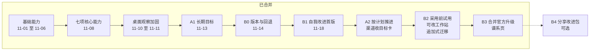

# OwnDesk 路线图

更新：2026-11-25

OwnDesk 先做好一个人、一台机器上的个人 Agent。这里记录已经合并的阶段、接下来的顺序，以及每个阶段做完的标准。阶段设计见[长期目标与自我改进设计](design/goal-and-self-evolution-plan.md)，详细验证历史见[开发状态](STATUS.md)。

在「版本」页可以检查官方更新，选择保留本地改进或只用官方版本。每个候选都保留需求、父版本、评测和花费；未通过的候选也可以作为下一次改进的起点。

## 已合并

| 时间           | PR                                                   | 交付内容                                                                              |
| -------------- | ---------------------------------------------------- | ------------------------------------------------------------------------------------- |
| 11-01          | #1、#2                                               | 陪伴聊天、Telegram/QQ/微信渠道                                                        |
| 11-03 至 11-04 | #3–#9                                                | 工作站中文化、陪伴阶段、记忆、网页推送、AT-SPI 原生控件                               |
| 11-06 至 11-07 | #10–#12                                              | 自托管安装、模型备用通道、格式和 CUA 修复                                             |
| 11-08          | #13–#17、#19、#20                                    | 聊天到任务连续性、办事记忆召回、文件上传、MCP/OAuth、聊天自动化、示范教学、跨应用流程 |
| 11-08          | #18                                                  | README 截图                                                                           |
| 11-10 至 11-11 | #21、#22                                             | 桌面有界观察树、审查加固                                                              |
| 11-13          | [#23](https://github.com/wudilyy999/owndesk/pull/23) | A1 长期目标：目标页、多轮推进、确认卡、暂停/停止、连续失败自动暂停                    |
| 11-14          | [#24](https://github.com/wudilyy999/owndesk/pull/24) | B0 版本底座：更新器、保留版本、健康检测、自动回退、版本页                             |
| 11-18          | [#25](https://github.com/wudilyy999/owndesk/pull/25) | B1 自我改进首版：隔离实验室、评测、报告、采用、自动回退和修复轮次                     |
| 11-18          | [#27](https://github.com/wudilyy999/owndesk/pull/27) | 前端整理：删除重复架构文案，统一工作区、页面导航、移动端布局和交付输入                |
| 11-24          | [#35](https://github.com/wudilyy999/owndesk/pull/35) | A2 定时推进、多渠道目标卡和跨轮交接                                                   |
| 11-25          | [#36](https://github.com/wudilyy999/owndesk/pull/36) | B2 隔离试用、追加式迁移、受限工作站与可恢复快照                                       |

11-08 七项能力的逐项实现和检查记录保留在[交付记录](DELIVERY-ROADMAP.md)，那份文件现在作为历史日志。

## 阶段交付与验收

### A2：按计划推进与多渠道

- 长期目标增加“按计划”节奏，复用定时例程的计划格式和调度器。
- Telegram、QQ、微信能收到目标确认卡和进度；Telegram 上可以暂停和继续。
- 轮次之间用 `SegmentSnapshot.handoff` 交接文件。

做完的标准：假时钟测试每日计划按时开轮次，再真实跑一次；错过的时间按 `missedRunPolicy` 处理；Telegram 暂停和继续可用；Telegram 和例程相关回归通过。

### B2：采用前试用、可改工作站、追加式迁移

- 采用前可以在网页里用合成数据试用候选版本。
- 增加受限 Docker API 代理。候选只能用固定参数启动固定工作站镜像，只能操作自己贴标签的容器，禁止 privileged 和挂载主机路径。之后桌面控制代码可以开放给自我改进。
- 允许追加式迁移，只能新增表和可空列；采用前做完整快照。

做完的标准：一个工作站相关改进通过真实 CUA 实测；启动 privileged 容器或挂载 `/` 的请求被拒绝；带迁移的版本回退后旧版正常运行、数据不丢；CUA 和原生控件回归通过。

### B3：合并官方升级与谱系页

- 把本地改进补丁合并到新的官方版本，冲突自动解决后重新跑全部测试，重复冲突用 `rerere` 复用解决结果。
- 谱系页显示每个版本的父版本、需求、测试结果、花费和状态，被拒绝的候选也能看到，并可基于旧候选继续改。
- 用户可以放弃本地改进，直接按官方版本升级，需求文字保留。

做完的标准：用真实的下一个官方版本合并一次，其中有冲突并自动解决，全部测试通过；被官方取代的改进自动丢弃；第二次遇到同样冲突由 `rerere` 解决。

开发者可在有完整 Git 历史的 Linux 工作树运行 `npm run test:evolution:rebase`：它使用相邻的两个真实官方提交，检查补丁去重、冲突复用和合并后的实际行为。`npm run test:evolution:lineage` 使用全新、已迁移的 `b3_lineage_probe` 测试库。真实模型测试 `tests/evolution-merge-live.ts --live` 另外需要空的 `b3_merge_probe` 库、独立 `EVOLUTION_DIR` 和 `B3_PROOF_DIR`、`OWNDESK_HISTORY_REPO`、`B3_LIVE_MODEL` 与 `B3_LIVE_ORIGIN`；用受信任的管道在标准输入提供测试中转配置，先核对主人月预算。

### B4：分享改进包（可选）

把一个本地改进导出成包含需求、补丁、测试和评测报告的改进包。别人导入后，在自己的机器上重新跑完整评测。默认关闭。

## 发布和部署

全新安装脚本现已初始化并核对 guest 网络，并通过单独的主人配置文件创建账号。隔离 Linux 验收覆盖真实登录、服务健康和重复安装保护。公开发布与公网部署仍待验收。

- 发布第一个 GitHub Release，并推送 web、worker、工作站的 GHCR 镜像。
- 降低候选构建的内存峰值，让 4 vCPU / 8 GB 机器在构建期间留出足够余量。
- 用真实 QQ、微信账号和 iPhone 验证渠道与推送。
- 在公网服务器和域名上完成一次完整部署。

## 长期缺口

这些能力会在上面的阶段之后按实际使用情况排期：

- 跨聊天、任务、成果和附件的统一检索
- 例程直接绑定来源聊天、手册和流程
- 更完整的连接器能力，例如邮件附件、全天和重复日程
- 示范教学的语义理解
- 更多浏览器、办公软件和跨应用流程模板
- 语音输入、朗读和实时通话
- 原生桌面和手机客户端
- 群聊、并行子任务和多 Agent 协作
- 团队使用
- 技能和插件生态
- 与同类产品在相同任务上的质量对比
