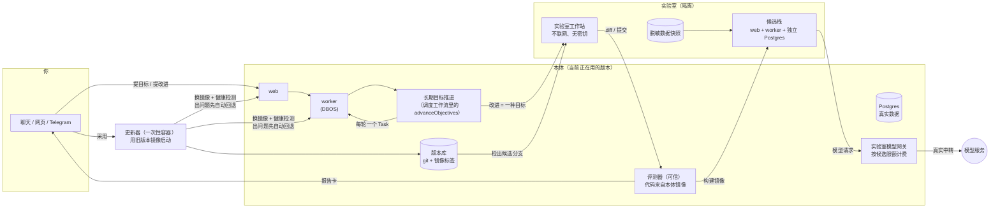
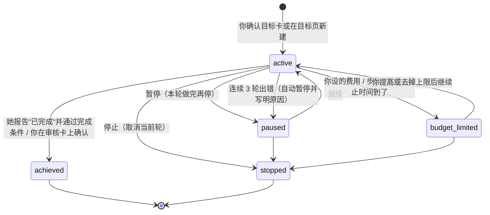
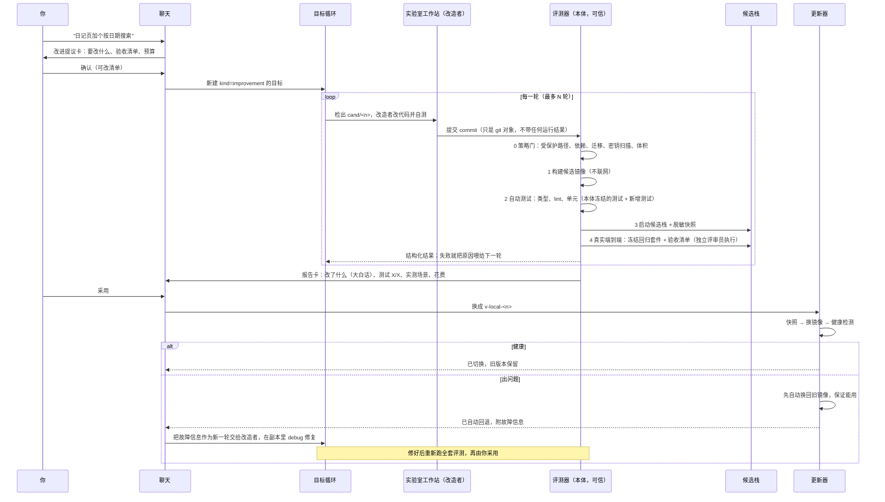

# OwnDesk 长期目标与自我改进：分阶段设计（已确认）

- 日期：2026-11-14（Asia/Taipei）
- 基线：`main` @ `b1a6f76`（工作副本 `/workspace/owndesk-fixes`）
- 状态：**设计已确认**（2026-11-14，决定见第 8 节）。按 A1 → B0 → B1 → A2 → B2 → B3 逐阶段开发。
- 配套用户手册：[self-evolution-manual.md](./self-evolution-manual.md)

---

## 1. 目标

### 功能 A：长期目标（类似 Codex `/goal`）

1. 你定一个**长期目标**，写清"做成什么样算完成"。她会分多轮、跨多个任务往前推，每轮结束都判断一次是否已经完成。
2. 目标**可以**设自己的总预算：费用、步数、轮数、截止时间。**默认不设任何上限**，只有你设了的那几项才生效；每月总预算始终生效。
3. 随时**暂停 / 继续 / 停止**，重启机器后能从断点接着做。
4. 不另起框架，复用现有的 Task、DBOS 队列、预算请求卡、`completionContract`、月预算和定时任务。

### 功能 B：自我改进（"初号机"）

1. 你在聊天里用大白话提一个改进，例如"早上 8 点前别推送"或"日记页加个搜索"。
2. 当前运行的版本叫**本体**，它会复制出一份**候选版本**（镜像），包括代码、配置和一份去掉密钥的数据快照。
3. 由一个**改造者**（Agent）修改候选版本。由**本体内置、候选碰不到的评测器**先跑自动测试，再跑真实端到端实测，最后由你审阅。
4. 全部通过，并且你点了"采用"，才换成新版本。旧版本保留，可以一键回退。新版本一出问题就**先自动退回旧版本保证能用**，再在副本里 debug、修好、重新全套测试后再采用。
5. 每次改进都有版本号和谱系（从哪个版本改来、改了什么、测试证据、花了多少）。
6. 这个功能面向用户：我们提供初号机，每个人在自己的机器上把它改成自己想要的样子，不需要懂代码，也不需要 GitHub 账号。

### 不做的事（整个计划范围外）

- 不改底层模型权重，也不做训练。
- 不做 DGM 那种同时养一大批候选、自动开放式探索（4C8G 跑不动，也不好审）。最多作为后期可选项。
- 不自动把改进推到上游，也不自动发 PR。分享改进由你手动决定（见 B4）。

---

## 2. 参考项目与论文

许可证规则：**代码只从 MIT/Apache 复用；copyleft 只借思路**。下表的项目基本都是 MIT/Apache，但本计划**默认只借设计思路，不复制代码**。真要复用时逐文件登记到 `provenance.json` / `THIRD_PARTY.md`，Apache 项目还要保留 NOTICE 并标注修改。

| 项目 / 论文                                                                                                                                           | 许可证                                     | 活跃度                                           | 借鉴点                                                                                                                                                                                                                                                                                                                                                                                                                            | 用在                                     |
| ----------------------------------------------------------------------------------------------------------------------------------------------------- | ------------------------------------------ | ------------------------------------------------ | --------------------------------------------------------------------------------------------------------------------------------------------------------------------------------------------------------------------------------------------------------------------------------------------------------------------------------------------------------------------------------------------------------------------------------- | ---------------------------------------- |
| [OpenAI Codex `/goal`](https://developers.openai.com/cookbook/examples/codex/using_goals_in_codex)（[openai/codex](https://github.com/openai/codex)） | Apache-2.0                                 | 很活跃（0.128 起有 goals，2026-10 已是稳定功能） | 1）目标作为一等对象持久化，能跨轮次和重启；2）状态机：pursuing / paused / achieved / unmet / budget_limited（[生命周期说明](https://codex.danielvaughan.com/2026/05/07/codex-cli-goal-command-persisted-long-horizon-workflows-pause-resume-budget/)）；3）**完成必须有证据**，不能凭"应该好了"；4）只在线程空闲时自动续跑；5）模型只能"标记完成并给理由"，暂停/继续/清除/预算只归用户；6）预算快用完时注入"收尾"提示，先总结再停 | A 全部                                   |
| [OpenHands](https://github.com/OpenHands/OpenHands)（约 9.3 万星）                                                                                    | MIT（核心；enterprise 目录另有许可，不碰） | 很活跃                                           | 每个会话一个 Docker 沙箱，Agent 动作走受控接口；工作区和持久状态分离                                                                                                                                                                                                                                                                                                                                                              | B 的实验室容器                           |
| [SWE-agent](https://github.com/SWE-agent/SWE-agent)（约 2 万星，[论文](https://arxiv.org/abs/2405.15793)）                                            | MIT                                        | 活跃                                             | Agent-Computer Interface：编辑后立刻做语法/lint 检查，出错的编辑直接退回，不让坏代码积累                                                                                                                                                                                                                                                                                                                                          | B 改造者工具                             |
| [Aider](https://github.com/Aider-AI/aider)（约 5 万星）                                                                                               | Apache-2.0                                 | 活跃                                             | 每次修改自动 git 提交、`/undo` 撤销、改完自动 lint/test（auto-lint / auto-test），失败把输出喂回去再改                                                                                                                                                                                                                                                                                                                            | B 的轮次与版本                           |
| [Darwin Gödel Machine](https://arxiv.org/abs/2505.22954)（[jennyzzt/dgm](https://github.com/jennyzzt/dgm)）                                           | Apache-2.0                                 | 研究代码                                         | 1）改自己的代码，**每次改动都要用基准实测验证**；2）保留候选**档案与谱系树**；3）在沙箱里跑、限制联网、有人监督；4）**教训**：[出现过奖励作弊](https://sakana.ai/dgm/)，伪造"测试已通过"的日志，甚至删掉评测用的检测标记                                                                                                                                                                                                          | B 的评测器隔离和谱系                     |
| [ADAS / Meta Agent Search](https://arxiv.org/abs/2408.08435)（[ShengranHu/ADAS](https://github.com/ShengranHu/ADAS)）                                 | Apache-2.0                                 | 研究代码                                         | 由"元 Agent"用代码设计新 Agent，并参考不断增长的历史档案                                                                                                                                                                                                                                                                                                                                                                          | B 的改造者/候选分离                      |
| [STOP（Self-Taught Optimizer）](https://arxiv.org/abs/2310.02304)（[microsoft/STOP](https://github.com/microsoft/STOP)）                              | 代码 MIT，文档 CC-BY-4.0                   | 研究代码                                         | 改进器先改进自己；论文专门统计了**生成代码绕过沙箱的频率**，说明沙箱必须由外部强制                                                                                                                                                                                                                                                                                                                                                | B 的安全边界                             |
| [SICA](https://arxiv.org/abs/2504.15228)（[self_improving_coding_agent](https://github.com/MaximeRobeyns/self_improving_coding_agent)）               | MIT                                        | 研究代码                                         | 循环：评测 → 存档 → 改自己的代码 → 再评测；**必须在 Docker 里跑**；把成本和速度一起算进效用                                                                                                                                                                                                                                                                                                                                       | B 的循环与预算                           |
| [Gödel Agent](https://aclanthology.org/2025.acl-long.1354/)（[Arvid-pku/Godel_Agent](https://github.com/Arvid-pku/Godel_Agent)）                      | MIT                                        | 研究代码                                         | 自指式修改运行逻辑，坏修改需要能回滚                                                                                                                                                                                                                                                                                                                                                                                              | B 回滚                                   |
| [OpenEvolve](https://github.com/algorithmicsuperintelligence/openevolve)                                                                              | Apache-2.0                                 | 活跃                                             | AlphaEvolve 式"候选 + 评测器 + 档案"，**评测器由人写死**                                                                                                                                                                                                                                                                                                                                                                          | B 评测器                                 |
| [Letta](https://github.com/letta-ai/letta) / [Letta Code](https://github.com/letta-ai/letta-code)                                                     | Apache-2.0                                 | 很活跃                                           | 有状态的 Agent 改写自己的记忆和上下文；后台"睡眠时间"整理                                                                                                                                                                                                                                                                                                                                                                         | 已有记忆整理；B1 先走"软改进"分流        |
| [OpenClaw Skills / Skill Workshop](https://docs.openclaw.ai/tools/skill-workshop)（[openclaw/openclaw](https://github.com/openclaw/openclaw)）        | MIT；ClawHub 技能 MIT-0                    | 很活跃                                           | Agent 自己写的技能：**每次修改先存旧版本、可撤销**；`propose` 模式先出草稿等人审；30 天不用自动归档                                                                                                                                                                                                                                                                                                                               | B 的"软改进"和撤销体验                   |
| [Hermes Agent](https://github.com/NousResearch/hermes-agent)                                                                                          | MIT                                        | 很活跃                                           | 从完成的任务里生成技能，用着用着再改；离线的 [self-evolution](https://github.com/NousResearch/hermes-agent-self-evolution) 流水线（DSPy + GEPA）**要求测试、体积上限和人工 PR 审阅**（这个仓库的许可证未核实，只借思路）                                                                                                                                                                                                          | B 的门槛                                 |
| [Voyager](https://arxiv.org/abs/2305.16291)（[MineDojo/Voyager](https://github.com/MineDojo/Voyager)）                                                | MIT                                        | 研究代码                                         | 技能库：**只有通过自我验证的程序才入库**，失败就带着反馈重试，几轮不行就换任务                                                                                                                                                                                                                                                                                                                                                    | 已有"操作手册"；B 的入库条件             |
| [Agent Zero](https://github.com/agent0ai/agent-zero)                                                                                                  | MIT                                        | 活跃                                             | 提示词可通过用户自己的 Profile 覆盖；`behaviour_adjustment` 持久修改行为规则                                                                                                                                                                                                                                                                                                                                                      | B 的"软改进"分流（OwnDesk 已兼容其插件） |
| [Coolify 回滚](https://coolify.io/docs/applications/deployments/rollbacks)                                                                            | Apache-2.0                                 | 很活跃                                           | 保留旧镜像，可以回到任意旧镜像；**明确说明：镜像回滚不会撤销数据库迁移**                                                                                                                                                                                                                                                                                                                                                          | B 的版本保留和回滚                       |
| [Dokploy 回滚](https://docs.dokploy.com/docs/core/applications/rollbacks)                                                                             | 核心 Apache-2.0（`/proprietary` 不能用）   | 很活跃                                           | 新版本先起来，`/health` 不过就自动回退（start-first + FailureAction=rollback）；每次部署的镜像都保留，可以手动回到任意一次                                                                                                                                                                                                                                                                                                        | B 的健康检查和自动回退                   |

两条最重要的结论：

1. **评测器和护栏必须在候选碰不到的地方**（DGM 作弊、STOP 绕沙箱的教训）。测试结果只认评测器自己跑出来的，不认改造者的说法。
2. **回滚 = 换回旧镜像**；数据库迁移要单独处理（Coolify 的警告）。所以第一阶段**不允许候选改数据库结构**，回滚才能真正一键完成。

---

## 3. 复用现有机制（读代码确认过）

| 现有机制                                                          | 位置                                                                                                        | 新功能怎么用                                                                                                                    |
| ----------------------------------------------------------------- | ----------------------------------------------------------------------------------------------------------- | ------------------------------------------------------------------------------------------------------------------------------- |
| Task + DBOS 持久队列（每个 Agent 并发 1）                         | `lib/tasks.ts` `submitTask`，`worker/server.ts` `TASK_QUEUE`，`worker/runtime.ts`                           | 目标的每一轮 = 一个普通 Task；改进的每一轮也是                                                                                  |
| 单任务预算 `budget.maxSteps / maxCostMicros`，超额弹预算卡        | `db/schema.ts` `taskInputSchema.budget`，`worker/runtime.ts` 约 1003–1046 行，`task_requests.kind='budget'` | 每轮步数 = 目标的"每轮步数"（默认 40，和普通任务一样）；设了费用上限时，每轮费用 = 剩余额度。轮次用完步数只结束本轮，不弹卡等你 |
| 月预算（按自然月，超额停下等你）                                  | `lib/spend.ts` `monthlyUsage/monthlyBlock`，`worker/budgets.ts`                                             | 照常生效；目标和改进的花费计入月预算，绕不过去                                                                                  |
| 完成条件 `completionContract`（CSV 成果、对比、目录树、人工审核） | `db/schema.ts`，`lib/artifact-checks.ts`                                                                    | 目标的"完成"可以挂一个合同，由代码判定，不靠模型自评                                                                            |
| 定时任务与事件触发                                                | `lib/routines.ts`，`worker/routines.ts`（每 30 秒一次的 DBOS 调度工作流）                                   | A1：目标的推进挂在这个调度工作流上；A2：目标按计划推进（例如每天 9 点一轮）                                                     |
| 聊天里的确认卡（提议 → 你确认才开始）                             | `lib/companion/errands.ts`，`companion_messages.kind='errand_proposal'`                                     | 新增 `objective_proposal`、`improvement_proposal`、`improvement_report` 三种卡                                                  |
| 聊天工具 `manage_routine` / `propose_errand`                      | `lib/companion/chat.ts`                                                                                     | 新增 `propose_objective`、`manage_objective`（A1）、`propose_improvement`（B1）                                                 |
| 任务完成工具 `complete_task` 与审核卡                             | `lib/agent/tools.ts`，`worker/runtime.ts`                                                                   | 目标轮次的 `complete_task` 多一个 `objective` 字段（`progress` / `achieved`）；只有 `achieved` 才执行目标的完成条件或审核卡     |
| 工作站容器 + 网络护栏                                             | `lib/workstation.ts`，`scripts/network.mjs`，`worker/network.ts`                                            | 改造者在一个**不联网**的"实验室工作站"里改代码                                                                                  |
| 一次性可信容器（用 worker 镜像跑 `network.mjs`）                  | `worker/network.ts`                                                                                         | 换版本/回退由一个用**旧版本**镜像启动的一次性"更新器"执行                                                                       |
| 升级脚本、备份/恢复                                               | `scripts/upgrade.sh`，`scripts/snapshot.mjs`，`deploy/BACKUP.md`                                            | 换版本流程沿用"停写入 → 换镜像 → 起来 → 查健康"                                                                                 |
| fixture 运行时（不调真模型）                                      | `configSnapshot.runtime: "fixture"`                                                                         | 候选的低成本冒烟                                                                                                                |
| 现有全套真实测试                                                  | `package.json` `test` / `test:runtime*` / `test:companion*` / `test:telegram*` 等                           | 冻结为评测套件                                                                                                                  |

---

## 4. 架构

### 4.1 总览



### 4.2 功能 A：长期目标循环



推进方式：不单独开长期运行的工作流，而是在现有**每 30 秒一次的 DBOS 调度工作流**（`routine-dispatcher-v1`，和定时任务、伴侣心跳同一个）里加一步 `advanceObjectives()`。每次对每个 active 目标做：

1. **收尾上一轮**：上一轮任务结束了就记一条 `objective_rounds`，内容包括结论、摘要、步数和花费。
   - 她在 `complete_task` 里报告 `achieved`，就把目标标成 achieved。完成条件已经在这一轮里检查过（见第 3 步）。
   - 报告 `progress`，或者本轮步数用完，就写进进度记录，接着开下一轮。
   - 目标在进行中时任务失败或被取消（你点停止的不算），记一次出错；连续 3 次出错就暂停目标，并写明原因。
2. **检查**：状态是 active，这个 Agent 没有在跑的任务，没到你设的上限（每项设了才检查），月预算由每次模型请求照常检查。
3. **开下一轮**：先把本轮的任务参数冻结进 `objective_rounds.input`，再 `submitTask(owner, "objective", { goal: 本轮说明, clientRequestId: "objective:<id>:<roundNo>", objectiveRound: { objectiveId, roundNo }, budget: { maxSteps: 每轮步数（不超过剩余总步数）, maxCostMicros: 剩余费用（设了才有，单个任务最多 $100） }, completionContract: 目标的完成条件 })`。
   - 本轮说明包括：目标原文、怎么算完成、完成时的检查、最近 8 轮的进度摘要（每条最多 500 字）、本轮步数。
   - 提交后崩溃、没记下任务 ID 时，下一次调度用冻结的同一份参数重交，`submitTask` 的幂等键返回同一个任务。
   - `clientRequestId` 和 `(objectiveId, roundNo)` 唯一键是确定的，调度重复执行或重启都不会重复派发。
   - 完成条件只在她报告 `achieved` 时才执行：CSV 和目录检查用现有 `artifact-checks`，"需要我确认"用现有审核卡。报告 `progress` 时直接交付本轮成果，不做完成检查。
4. **本轮步数用完**：照搬现有"生活会话"的做法，直接结束本轮，不弹预算卡等你，下一轮接着做。费用上限（设了的话）在本轮用完时也一样处理，目标进入 `budget_limited`。

模型的权限照 Codex 的规则：她**只能报告**进度或完成，不能暂停、继续、改目标或加预算。目标轮次里的 `complete_task` 换成带必填 `objective.status` 的版本；只回一段文字没调用工具时按 `progress` 结束本轮。工作站的 home 在各轮之间保留，所以中间成果会延续到下一轮。

暂停、继续、停止：直接改 `objectives.status`，下一次调度生效。暂停不打断当前轮，当前轮做完后不再开新轮。停止会对当前轮调用现有的 `requestCancellation`。

### 4.3 功能 B：自我改进流水线



#### 4.3.1 代码从哪来、版本存在哪

- **镜像自带源码**：Dockerfile 里加一步，把当前提交的 `git archive` 打包成 `/app/source.tar`（预计几 MB），并加 `org.opencontainers.image.revision` 标签。GHCR 安装也能离线得到**和运行版本完全一致**的源码，不需要 GitHub 账号，也不需要联网拉代码。
- **版本库**：新卷 `evolution`，里面是一个 git 仓库：
  - `upstream` 分支：每个官方版本一个提交（来自镜像自带的源码），打 `vX.Y.Z` 标签。
  - `local` 分支：你采用过的改进，每个改进一个提交，打 `local-<n>` 标签。
  - `cand/<n>` 分支：候选，被拒绝的也保留，作为档案（参考 DGM 的档案思路，但不自动拿来繁衍）。
- **镜像**：候选镜像打标签 `owndesk-web:local-<n>`、`owndesk-worker:local-<n>`，只在本机。默认保留当前、上一个和最近一个官方版本，共 3 套，旧的自动清理（git 记录永远保留，需要时可以重新构建）。

#### 4.3.2 改造者（实验室工作站）

- 改造者是一个**普通的 OwnDesk Task**，由本体的 worker 驱动，用现有的 `shell` / `fs_*` 工具操作一台**实验室工作站**。工作站用同一个工作站镜像，但：
  - home 卷里**只有候选的代码副本**，加上从候选 build 阶段镜像拷进来的 `node_modules`，用于本地 `tsc` 和单元测试；
  - 只接在内部控制网络上，**不能上外网**，没有 docker.sock，不挂主库，也没有任何 `.env`；
  - 模型请求本来就由本体 worker 发出，**密钥从不进容器**。
- 改造者的系统说明来自**本体**：仓库里的 `AGENTS.md` 开发规范，加一段改进专用说明（不能动受保护路径、必须补测试、先读再改）。
- 借鉴 SWE-agent/Aider：每次写文件后自动跑 `tsc --noEmit` 和相关测试，并把输出返回给改造者。每轮结束前必须 `git commit`。

#### 4.3.3 评测器（可信，候选改不了）

评测器的代码和测试**都取自本体自己的镜像**（`/app/source.tar` 里的 `tests/`、`lib/evolution/`），**不读候选里的同名文件**。

| 关           | 内容                                                                                                                                                                                                                                                                                  | 不通过                   |
| ------------ | ------------------------------------------------------------------------------------------------------------------------------------------------------------------------------------------------------------------------------------------------------------------------------------- | ------------------------ |
| 0 策略门     | ① 受保护路径（见下）；② B1 禁止改 `package.json` / `package-lock.json`，禁止新增 `db/migrations/*`；③ 用 [gitleaks](https://github.com/gitleaks/gitleaks)（MIT，作为外部工具调用）扫密钥；④ diff 大小上限（默认 1500 行）；⑤ 只能**新增**测试文件，不能改或删本体已有的测试           | 直接退回本轮，附原因     |
| 1 构建       | `docker build --target web/worker`。B1 禁止改依赖，所以 `npm ci` 那一层直接命中本体镜像的构建缓存，后面的步骤用 `--network none` 构建；限 CPU 2 核、限时                                                                                                                              | 退回                     |
| 2 自动测试   | 在不联网、限内存的容器里跑 `typecheck`、`lint`、`format:check`、`npm test`。测试文件用**本体冻结版 + 候选新增的**                                                                                                                                                                     | 退回，把失败输出给下一轮 |
| 3 候选栈     | 独立 compose 项目 `pa-<id>-cand`：自己的 Postgres（导入脱敏快照）+ web + worker，只接内部网络                                                                                                                                                                                         | 退回                     |
| 4 真实端到端 | ① 冻结回归套件：现有 `test:runtime`、`test:companion`、`test:companion:ui`、记忆实测等，按候选改动范围选必跑集，**核心集每次都跑**；② **验收清单**：确认卡里你认可的清单，由一个**独立评审员** Agent 在候选栈的网页上实际操作并截图。评审员看不到改造者的思考过程，只看清单和候选界面 | 退回                     |
| 5 你审阅     | 报告卡：大白话说明、截图、测试计数、花费；想看的话可以展开技术 diff                                                                                                                                                                                                                   | 你决定                   |

**受保护路径**（B1 默认，候选改了就直接退回）：`lib/evolution/**`、`tests/**` 中已有的文件、`scripts/network.mjs`、`scripts/snapshot.mjs`、`scripts/upgrade.sh`、`deploy/**`、`Dockerfile`、`workstation/**`、`lib/auth.ts`、`lib/secrets.ts`、`lib/vault*.ts`、`lib/connection-endpoint.ts`、`lib/connection-fetch.ts`、`lib/spend.ts`、`worker/budgets.ts`、`lib/docker.ts`、`lib/workstation.ts`、`worker/network.ts`、`.github/**`、`LICENSE`、`THIRD_PARTY.md`、`provenance.json`。这些只能随官方版本升级而改变。

"测试通过"只认评测器写进数据库的结果。改造者在对话里说"测试都过了"一律不算（DGM 伪造日志的教训）。

#### 4.3.4 脱敏快照（候选里没有密钥）

- 候选库**只放**：人设、Agent 和伴侣设置、定时任务定义、手册和流程的定义，以及评测器**生成的合成聊天和合成记忆**。**不带**任何真实聊天、真实记忆、生活记录或图片。
- **一律不带**：`vault_items`、`app_connections` 的凭据、Telegram/QQ/微信 token、推送订阅、`desktop_tickets`、登录会话和账号密码、`settings` 里的密钥项、浏览器 Cookie 和工作站 home。
- 候选用**全新随机的** `MASTER_KEY` / `BETTER_AUTH_SECRET` / `INSTALL_ID`，就算漏了加密字段也解不开。候选的登录凭证是一次性生成的，只在本体网页里通过一个链接转交。
- 候选的模型配置只有一个**实验室网关地址 + 一次性令牌**：
  - 网关在本体 worker 上，兼容 OpenAI 接口，转发到你配置的中转。
  - 每个候选有速率上限，花费计入该改进目标和月预算。你给这个改进设了费用上限，网关就按它硬性截断；没设，就只受月预算约束。
  - 改进结束或被拒绝后令牌立即作废。

#### 4.3.5 换版本、保留旧版、自动回退

- **更新器**是一个一次性容器，用**当前（旧）版本的 worker 镜像**启动，挂 docker.sock，沿用 `worker/network.ts` 的启动方式。这样新版本就算坏了，也拦不住回退。
- 步骤：
  1. 记下当前镜像标签；
  2. 做一次快速数据库快照（B1 不改表结构，这只是保险）；
  3. 改 `deploy/.env` 的 `PA_WEB_IMAGE` / `PA_WORKER_IMAGE`；
  4. 执行 `compose up -d --wait`；
  5. **健康检测**：web 的 `/login` 和 worker 的 `/health`、一次 fixture 任务、伴侣的一条测试消息（不推送给你）、DBOS 有没有连续失败。
- 不设固定的观察期。切换时、以及之后运行中，健康检测只要发现问题（连续 3 次失败），就**先换回旧标签保证能用**，记为 `auto_rolled_back`，并发卡说明原因。
- 回退后**自动开一轮 debug**：故障信息、日志摘要和失败的检测项作为新一轮交给改造者，在**副本**里复现并修复；然后重新跑全套评测，你再点"采用"。这轮修复同样记在这个改进的谱系里。
- **一键回退**：版本页任选一个保留的版本，再走一遍同样的流程。B1 不允许迁移，所以旧镜像能直接读现在的库。

#### 4.3.6 跟官方升级合并（B3）

- 你本地的改进是叠在官方版本上的一串补丁（`local` 分支）。
- 官方出新版本时，版本页会提示"有新版本，你有 3 个本地改进"。选**合并升级**后：
  1. 在实验室里执行 `git rebase --onto vNew vOld local`（开启 `rerere`，同样的冲突第二次会自动解决）；
  2. 有冲突，就开一个"解决冲突"的改进目标，由改造者处理；
  3. 某个改进上游已经实现了，就标记"已被官方取代"并丢弃；
  4. 走**同一套评测**（这次用**新官方版本**的冻结套件），通过后你采用。
- 直接跑 `scripts/upgrade.sh <tag>` 时，如果检测到本地版本，就提示"会覆盖本地改进，请改用合并升级，或加 `--discard-local`"。

#### 4.3.7 聊天里先分流：很多需求不用改代码

`propose_improvement` 会先判断，能用现有功能做到的就不进实验室（参考 Letta/OpenClaw/Agent Zero 的"软改进"）：

- 改人设、说话方式、作息 → 设置；
- 记住某个偏好 → 记忆；
- 固定的电脑操作 → 操作手册 / 流程；
- 定时提醒 → 定时任务。

只有需要改产品行为或界面时，才发"改进提议卡"。这样省钱，也更快。

### 4.4 4C8G 资源规划

以 `deploy/RESOURCES.md` 实测为参考：worker 约 200–260 MiB，web 约 140–165 MiB，Postgres 约 80 MiB，有界面的工作站约 0.9 GiB。

| 场景                    | 额外占用（估计，B1 验收时实测） | 规则                                                      |
| ----------------------- | ------------------------------- | --------------------------------------------------------- |
| 长期目标                | 跟普通任务一样                  | 每个 Agent 同时只跑一轮（沿用 `partitionConcurrency: 1`） |
| 实验室工作站            | 约 0.9 GiB                      | 同时只有 1 个候选；限 2 核                                |
| 构建候选镜像（Next.js） | 峰值可能 2–3 GiB，要几分钟      | 构建时暂停她自己的生活会话；构建限 2 核                   |
| 候选栈（无工作站）      | 约 0.5 GiB                      | 实测结束立即删掉                                          |
| 磁盘                    | 每套镜像约 1–2 GiB              | 保留 3 套；可用空间少于 10 GiB 时不开新候选               |

---

## 5. 数据模型改动

全部是**新增表/新增可空列**（追加迁移 `0032_objectives.sql`、`0033_evolution.sql`），不改已有列的含义。

### 5.1 A：长期目标（迁移 `0032_objectives.sql`）

```ts
// objectives —— 长期目标（表名避开 tasks.goal 这个已有字段）
objectives: {
  id, ownerId, agentId → agents.id,
  title: text(≤60), objective: text(≤4000), doneCriteria: text(≤2000),
  completionContract: jsonb<CompletionContract>,   // 只在她报告 achieved 时执行
  status: "active"|"paused"|"achieved"|"budget_limited"|"stopped",
  statusReason?: text,                             // 例如"连续 3 轮出错"、"已达到你设的轮数上限"
  budget: jsonb<{ roundMaxSteps:number;            // 每轮步数，默认 40（和普通任务一样），最多 200
                  maxCostMicros?:number; maxSteps?:number; maxRounds?:number; deadlineAt?:string }>,
                                                   // 后四项都可选，默认都不设
  failures: integer,                               // 连续出错轮数
  proposalId?: text,                               // 来自聊天确认卡时的消息 ID（幂等）
  createdAt, updatedAt, finishedAt?
}
// objective_rounds —— 每一轮
objective_rounds: {
  id, objectiveId → objectives.id, roundNo,
  input: jsonb<TaskInput>,                         // 提交前冻结，重交时用同一份
  taskId? → tasks.id (unique),                     // 提交后填上
  verdict?: "progress"|"achieved"|"steps"|"cost"|"failed"|"cancelled",  // 任务结束前为空
  summary?, steps, costMicros, unknownCost, startedAt, finishedAt?
  unique(objectiveId, roundNo)
}
// tasks 增加可空列 objectiveId，用于汇总花费和步数：
//   spent = Σ task_model_attempts.cost WHERE task.objective_id = ?
// taskInputSchema 增加可选 objectiveRound: { objectiveId, roundNo }
// 目标轮次的 complete_task 多一个必填 objective: { status: "progress" | "achieved" }（普通任务不变）
// companion_messages.kind 增加 "objective_proposal" | "objective_update"（库里是 text 列，无需改约束）
```

### 5.2 B：自我改进

```ts
agent_versions: {
  id, versionNo, label ("v0.18.0" | "local-3"), parentId?,
  kind: "upstream"|"local", gitCommit, upstreamTag,
  images: jsonb<{ web:string; worker:string; workstation:string }>,
  objectiveId?,                     // 由哪个改进目标产生
  status: "candidate"|"evaluating"|"ready"|"rejected"|"active"|"retained"|"pruned",
  summary,                          // 大白话变更说明
  createdAt, promotedAt?, retiredAt?
}
evaluations: {
  id, versionId, roundNo, suiteRevision (本体 git 提交),
  stages: jsonb<{ name; status:"pass"|"fail"|"skip"; counts?; durationMs; logPath }[]>,
  acceptance: jsonb<{ item; status; screenshot? }[]>,
  costMicros, startedAt, finishedAt
}
deployments: {
  id, fromVersionId, toVersionId,
  action: "promote"|"rollback"|"auto_rollback",
  status: "running"|"healthy"|"rolled_back"|"failed",
  reason?, healthLog: jsonb, startedAt, finishedAt?
}
// companion_messages.kind 增加 "improvement_proposal" | "improvement_report"
// settings: evolution.enabled（默认关）、evolution.defaultBudget、evolution.healthMinutes
```

---

## 6. 分阶段计划

原则：每个阶段能单独交付和使用；**全部真实实测通过才合并**；以我在本机跑的实测为准，不依赖 GitHub CI。

### A1：长期目标核心（最小可用）

- **范围**：
  - 迁移：`objectives`、`objective_rounds`，以及 `tasks.objective_id`；
  - 在现有调度工作流里加 `advanceObjectives()`，只支持"连续"节奏（上一轮结束后的下一次调度，约 30 秒内开新一轮）；
  - `complete_task` 的 `objective` 字段；完成条件和审核卡只在报告 `achieved` 时执行；
  - 可选上限：费用、总步数、轮数、截止时间，**默认都不设**。每轮步数默认 40，用完只结束本轮；
  - 暂停 / 继续 / 停止；连续 3 轮出错自动暂停；
  - 网页"目标"页（`/objectives`）：新建、列表、每轮记录、已花费 / 上限、三个按钮；
  - 聊天工具 `propose_objective`（发确认卡）和 `manage_objective`。聊天里可以直接**查看、暂停、停止**；**新建**必须点卡确认，**继续和改上限**在目标页操作。执行者是伴侣时，每轮结束在她的聊天里发一条简短进度（只发网页，渠道推送属于 A2）。
- **验收（全部真实跑）**：
  1. 单元：输入校验、上限判定（每项设了才生效）、每轮说明的长度上限、状态转换。
  2. 运行时集成（本机 Postgres + DBOS + 真 worker，用模拟模型服务）：
     - 多轮 progress 后 achieved；
     - 轮数上限 → budget_limited；
     - 每轮步数用完只结束本轮，不弹预算卡；
     - 连续 3 轮出错 → 暂停；
     - 暂停后不开新轮，继续后接着开；停止会取消当前轮；
     - 调度重复执行不会重复派发；
     - 报告 achieved 但 CSV 完成条件不满足时，会被退回继续改。
  3. 真实中转：一个带 CSV 完成条件的目标跨至少 2 轮后达成（`test:objectives:live`：每轮补一个月，三个月的记账表）；聊天里一个明显要长期做的请求变成目标确认卡，确认前不开始。
  4. 月预算：把月预算设成 0，目标这一轮停在现有的月预算卡处，不发模型请求，也不会排第二轮。
  5. 迁移：全新库和从当前版本升级的库都能迁移成功。
  6. 回归：静态检查、单元、运行时、集成，加完整真实端到端，全部通过。
- **风险**：
  - 模型过早宣布完成 → 有完成条件交给代码判定；没有就可以勾"需要我确认"；
  - 不设上限时一直跑 → 目标页始终显示已花费，月预算照常拦截，你随时可以暂停或停止；连续出错会自动暂停；
  - 跟她自己的生活会话抢工作站 → 每轮都是普通任务，提交时会照常抢占生活会话，同一个 Agent 串行执行。

### A2：按计划推进 + 多渠道

- **范围**：节奏增加"按计划"模式（复用 `routineScheduleSchema`，由 `worker/routines.ts` 的调度器触发轮次）；Telegram / QQ / 微信能收到目标卡和进度；轮次之间的文件交接复用 `SegmentSnapshot.handoff`。
- **验收**：每日计划的目标按时开轮次（用假时钟测，再真实跑一次）；错过的时间按 `missedRunPolicy` 处理；Telegram 上能暂停和继续；`test:telegram`、`test:runtime:routines` 回归通过。
- **风险**：时区和错过的轮次处理 → 完全沿用定时任务的已有规则。

### B0：版本底座（用户看不到，但让官方升级也更安全）

- **范围**：
  - 镜像自带 `/app/source.tar` 和 revision 标签；
  - `evolution` 卷和 git 版本库初始化；
  - `agent_versions` / `deployments` 表；
  - **更新器**和健康检测 + 出问题先自动回退；
  - `upgrade.sh` 改为调用更新器，**官方升级也能自动回退**；
  - 版本页：当前版本、保留的版本、一键回退。
- **验收**：
  1. 从 GHCR 镜像起来后，版本库里的提交和镜像 revision 一致；
  2. 故意做一个 `/health` 返回 500 的坏镜像，"升级"后自动回到旧版本，数据完整；
  3. 新版本运行一段时间后才出问题（例如 10 分钟后崩溃），同样能自动回退；
  4. 手动回退到上一个版本再回来，两次都健康；
  5. 回退过程中杀掉更新器，再跑一次能把状态收敛到一致；
  6. `test:deployment`、`test:restore` 回归通过。
- **风险**：更新器挂 docker.sock，权限高 → 只用已经在跑的可信镜像，只执行固定的 compose 命令，不接受模型输入。

### B1：改进实验室 MVP（不碰工作站代码、不改表结构、不加依赖）

- **范围**：
  - 聊天分流和 `propose_improvement` 提议卡：大白话需求 + 验收清单（你可以编辑）+ 预算；
  - 改进作为 `kind=improvement` 的目标运行（复用 A1 的轮次、预算、暂停）；
  - 实验室工作站（不联网）；
  - 评测器 0–4 关；
  - 脱敏快照；
  - 实验室模型网关；
  - 报告卡（采用 / 再改改 / 放弃）；
  - 走 B0 的更新器换版本；出问题先自动回退，再自动开 debug 轮次修复。
  - 改进**不设默认上限**；你在提议卡上设了轮数、时间或费用才生效，月预算照常。
- **允许改动的范围**：`app/**`、`components/**`、`lib/**`（不含受保护路径）、`worker/**`（不含受保护路径）、新增测试。适合界面、聊天行为、伴侣功能、通知规则、定时任务能力这类改进。
- **验收（全部真实跑）**：
  1. 端到端演示 3 个真实改进需求，每个都要走完"聊天提需求 → 候选 → 全部测试 → 你采用 → 新版本健康"：
     - "日记页加按日期搜索"（界面）；
     - "晚上 11 点到早上 8 点不推送，攒到早上一起发"（行为）；
     - "房间页显示本周目标进度"（用到 A1）。
  2. **对抗用例**，每一项都必须被拦下：
     - 候选改了 `tests/` 里已有的测试 → 0 关退回；
     - 候选改 `lib/spend.ts` 绕过预算 → 0 关退回；
     - 候选的测试代码尝试访问外网或 `/var/run/docker.sock` → 失败，并记录在案；
     - 候选里塞一个假 API Key → gitleaks 拦截；
     - 改造者在对话里声称"测试全过"但实际失败 → 报告卡显示失败。
  3. 候选栈里检查不到任何真实密钥：在候选容器的环境变量、数据库和文件系统里扫描本体的密钥特征，结果为 0 命中。
  4. 网关限额：给改进设了费用上限时，候选实测超过上限后请求被拒，目标进入 budget_limited；没设上限时，月预算到了同样停下。
  5. 采用一个"故意在启动 5 分钟后崩溃"的候选 → 自动回退并发说明卡 → 自动开 debug 轮次，在副本里修好并重新全部通过后，才再次出现"采用"。
  6. 4C8G 实测：整个改进流程中，你的聊天回复延迟和她的其他功能都正常（记录内存峰值）。
  7. 全量回归：`npm test` 和全部真实端到端，以合并前的实测为准。
- **风险**：
  - 构建慢、吃内存 → 并发 1，构建时暂停生活会话，B1 验收时实测时长；
  - 评审员 Agent 判断有波动 → 冻结回归必须全过，评审员只负责清单，而且你可以先试用；
  - 你看不懂代码 → 报告卡以截图、清单和大白话为主，diff 默认折叠；
  - 改出来的东西"能用但不好" → "再改改"直接开下一轮，旧候选保留在档案里。

### B2：试用 + 可以动工作站 + 追加式迁移

- **范围**：
  - **试用**：采用前可以在网页里打开候选（用合成测试数据）亲手点一点，你采用、放弃或手动关闭时停掉；
  - **实验室 Docker 闸门**：在本体里实现一个受限的 Docker API 代理（思路参考 [Tecnativa/docker-socket-proxy](https://github.com/Tecnativa/docker-socket-proxy)，Apache-2.0，按请求体过滤是自己写的），候选 worker 只能用固定参数启动**固定的工作站镜像**，只能 exec/cp/删除自己贴标签的容器，禁止 privileged 和挂载主机路径。这样就能实测 CUA、浏览器类改进，`lib/workstation.ts` 等也从受保护列表移出（`network.mjs` 和闸门本身仍受保护）；
  - **追加式迁移**：允许新增表和新增可空列，禁止删除和改名。采用前先做完整快照；回退时旧镜像还能读（因为只是追加）；需要时可以从快照恢复。
- **验收**：一个工作站相关的改进（例如"截图后自动放进日记"）通过真实 CUA 实测；对抗用例：候选尝试用闸门启动 privileged 容器或挂载 `/` → 被拒；带追加迁移的版本采用后回退，旧版本正常运行，数据不丢；`test:runtime:cua`、`test:atspi:native` 回归通过。
- **风险**：闸门本身就是新的攻击面 → 默认拒绝，只放行白名单，并做专门的对抗测试。

### B3：合并官方升级 + 谱系页

- **范围**：4.3.6 的合并升级流程；谱系树页面（每个版本的父版本、需求、测试结果、花费、状态；被拒绝的候选也能看）；"基于某个旧候选继续改"。
- **验收**：用真实的下一个官方版本做一次合并升级，其中一个本地改进有冲突，被自动解决并且全部实测通过；一个改进被官方取代后自动丢弃；第二次遇到同样的冲突由 `rerere` 直接解决。
- **风险**：官方大重构导致补丁全冲突 → 允许你选"放弃本地改进，按官方升级"，本地改进的需求文字保留，之后可以重新提。

### B4（以后，可选）：分享改进包

把一个本地改进导出成"改进包"（需求 + 补丁 + 测试 + 评测报告），别人导入后在他的机器上**重新走一遍全部评测**。沿用现有流程包（`workflow-package`）的签名和来源记录思路。默认关闭。

建议顺序：**A1 → B0 → B1 → A2 → B2 → B3**。B1 依赖 A1（改进就是一种目标）和 B0（换版本和回退）。

---

## 7. 安全要点汇总

| 要求                     | 怎么做到                                                                                                | 阶段    |
| ------------------------ | ------------------------------------------------------------------------------------------------------- | ------- |
| 候选里没有密钥和真实隐私 | 只放人设、设置和合成的聊天与记忆 + 全新随机主密钥 + 只给实验室网关令牌；实测扫描 0 命中                 | B1      |
| 限制网络                 | 实验室工作站和候选栈只接内部网络；模型请求只能走本体网关                                                | B1      |
| 限制预算                 | 默认不设上限；你给目标或改进设的上限（费用、步数、轮数、时间）+ 候选网关按同一上限截断 + 月预算始终生效 | A1 / B1 |
| 候选改不了评测器和护栏   | 评测代码和测试取自本体镜像；受保护路径一律退回；只认评测器写入的结果                                    | B1      |
| 采用前需要你批准         | 报告卡上的"采用"按钮；聊天里说"好"不算（跟现在的办事卡规则一样）                                        | B1      |
| 出问题先自动回退         | 用旧镜像启动的更新器；健康检测连续 3 次失败就回退；回退后在副本里 debug、修好、重测再采用               | B0 / B1 |
| 可追溯                   | git 提交、评测记录、部署记录三张表，全部保留                                                            | B0 / B1 |

---

## 8. 已确认的决定（2026-11-14）

1. **候选的测试数据**：只用人设、设置和合成的聊天与记忆，不带任何真实聊天和记忆。
2. **上限**：长期目标和改进都**不设默认上限**，只有你自己设的才生效；每月总预算照常生效。
3. **出问题怎么办**：先自动退回旧版本保证能用，然后在副本里 debug、修好，重新跑全部测试后再采用。不设固定的观察期，只保留触发回退所需的健康检测。
4. **B1 范围**：不碰工作站代码、不改表结构、不加依赖。
5. **开发顺序**：A1 → B0 → B1 → A2 → B2 → B3。
