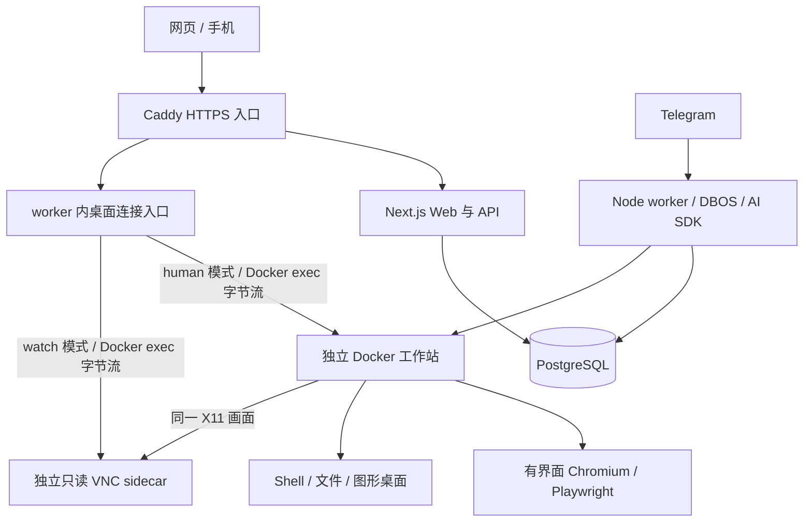

# 详细架构与数据设计

## 当前增量：CUA 流程编译（设计稿1.25，2026-10-26）

用户已确认“成功任务沉淀为参数化自动化流程”的技术方向。按 C0—C5 推进：现场与基线→轨迹提炼→确定性执行→局部修订→全成本对照→流程分享。复用单 Agent、原 Task/DBOS/动作与控制链；多 Agent 继续暂缓。

详见 [流程编译设计](CUA流程编译与自动化复用.md) 和 [主会话指导](主会话指导-流程编译.md)。这是已确认、待实现的设计增量；下方旧版本和验收记录保留其日期与范围。本次没有改变应用版本、SQL、镜像或运行服务。

状态：架构基线与实现补充。规划范围和已经实现的范围分别登记；当前状态见代码工程 docs/STATUS.md，模型协议见《模型执行与成果验证》。

## 1. 部署与职责

初期 Compose 包含 Web、worker、PostgreSQL、Caddy 四类服务。工作站由 worker 创建为同机 Docker 容器。桌面连接入口属于 worker 的内部服务，不另建微服务。

- Web：拥有者认证、配置、提交与查询、成果下载、SSE、桌面票据签发。
- Worker：DBOS 注册与执行、模型与工具调用、Telegram polling、计划管理、工作站维护、控制连接。
- PostgreSQL：业务 schema、认证表和 DBOS 系统记录。同一实例使提交与入队可使用同事务。
- 工作站：浏览器、图形显示、命令与文件。控制器经 Docker exec 请求；0.8.1-dev 桌面也走 stdio，不发布 guest 端口。guest 出站限制继续由 P7 宿主网络策略验证。
- 只读 sidecar：独立受控的观看服务，不把可由 Agent Shell 修改的工作站进程当作观看授权边界；由 worker 随工作站管理。
- Caddy：统一 HTTPS/WSS 入口。数据库、Docker API、浏览器控制端口不公开。

Web 与 worker 共享业务代码和类型。AI SDK 与工具执行不在 Next.js 请求生命周期里运行。初期只允许一个 worker 副本，部署配置应阻止误启动第二份 Telegram polling 和工作站维护器。

## 2. 三个标识：任务、执行段、动作

| 名称              | 含义                                | 示例                                |
| ----------------- | ----------------------------------- | ----------------------------------- |
| Task              | 用户交办的一件工作                  | “整理本周报表”                      |
| Execution segment | 在一个 Agent/工作站上执行的一段工作 | A 工作站下载资料；交接给 B 继续处理 |
| Action            | 一个需要执行、记录与核对的工具动作  | 下载某份 CSV                        |

首条工作流只有一个执行段。发生明确的 Agent/工作站交接，或用户同意在原段结束后继续时，才新建执行段。每个执行段对应一个 DBOS workflow，队列分区是它的工作站 ID。

一个 Thread 可以包含多轮 Task，每轮有独立目标、完成条件与成果。thread_turn 明确轮次顺序；同一个对话同时只有一轮活跃任务。新的追问创建新 Task，旧任务和交付物保持原记录。

业务任务不会因为一次交接而被标为完成。DBOS workflow ID 采用稳定的 `taskId + segmentNo` 组合；动作标识由执行段和逻辑动作序号确定。随机值和时间在持久化边界生成、保存，恢复时使用记录值。

此划分保留 上游项目 的顺序交接能力，解决“在 A 工作站排队的运行却直接控制 B 工作站”的资源归属问题。初期不实现并行分支或任意 DAG 编辑器。

## 3. 数据模型

### 3.1 沿用的实体

保留 agents、threads、messages、memories、routines、routine_runs、turns、vault_items、settings、squads 和 squad_members 的业务含义。继续使用已有字符串 ID、消息 parts、金额整数单位和 UI 所需字段。

PostgreSQL 的查询改为异步；时间统一存储为 UTC 时间戳，展现和例程使用用户 IANA 时区。JSON 字段迁移时保持消息格式。DBOS schema 由 SDK 管理，业务迁移不得修改它的内部表。

### 3.2 新增记录及约束

| 记录                 | 关键字段                                                                                                                                    | 不变量                                                                    |
| -------------------- | ------------------------------------------------------------------------------------------------------------------------------------------- | ------------------------------------------------------------------------- |
| tasks                | id、ownerId、threadId、threadTurn、goal、completionContract、status、activeSegment、configSnapshot、budget、cancelRequestedAt、nextEventSeq | 一个用户请求对应一个任务；目标与完成条件有版本。                          |
| task_segments        | taskId、segmentNo、agentId、workflowId、snapshot                                                                                            | 一个执行段对应唯一工作流与工作站队列；0.13顺序交接已有受控证据。          |
| task_model_decisions | taskId、segmentNo、decisionNo、epoch、status、attempts、uncertainAttempts、result、costMicros                                               | 先保存请求意图和业务回答，未知计费保持可见。                              |
| task_model_attempts  | task/segment/decision/attempt、model、startedAt、priceSnapshot、usage、costMicros、reconciledCostMicros、legacy                             | 实际请求独立计费；原回执与人工核对分列；价格不随之后配置更新              |
| task_actions         | taskId、segmentNo、actionNo、dispatchId、epoch、bootId、kind、input、effectClass、receipt、status                                           | 逻辑动作标识唯一；派发尝试分表。                                          |
| task_action_attempts | taskId、segmentNo、actionNo、attemptNo、dispatchId、epoch、bootId、receipt、status、secretReleasedAt                                        | 尝试标识唯一；敏感派发权先消耗，未知结果不自动重发。                      |
| task_events          | taskId、seq、key、type、payload                                                                                                             | taskId+seq 和 taskId+key 唯一，按已提交序号续读；原子记忆回执也保存在此。 |
| artifacts            | id、taskId、name、storagePath、mediaType、size、verification                                                                                | 文件位置来自服务端；下载 API 不接受任意路径。                             |
| task_requests        | id、taskId、agentId、segmentNo、actionNo、kind、payloadVersion、decision、response、status                                                  | 用户回复对应当前待处理请求和版本，决定与唤醒一致提交。                    |
| workstation_control  | agentId、mode、desiredMode、epoch、bootId、activeTaskId、activeSegment、activeActionId、requestId                                           | 一个 Agent 的专属工作站控制现场；密文 connectionSecret 不向网页返回。     |
| desktop_tickets      | token、ownerId、sessionId、agentId、mode、epoch、expiresAt、usedAt                                                                          | 票据用途、会话、工作站、有效期与控制代数绑定。                            |

按阶段创建实际需要的表，不在 P0 提前生成全部结构。认证表由 Better Auth 选定版本的迁移生成。

`task_actions` 保存外部效果和验证证据。DBOS 负责执行账本，避免业务表重复实现步骤调度器。截图和长日志存文件，事件保存引用与必要摘要。

原付款审批界面和校验逻辑可复用；新等待流程统一落在 task_requests，通过适配函数提供旧卡片所需形状。首版不同时维护两套有独立决定权的审批状态。

### 3.3 请求去重

Web 请求包含稳定的 clientRequestId，Telegram 使用其 update/message 标识作为来源键。业务唯一约束为拥有者、来源与请求键的组合。

同一请求键再次提交：参数一致时返回已有任务；参数不同返回冲突。比较标准化后的业务字段，不额外维护散列指纹。

### 3.4 配置与凭据

任务保存模型标识、模板/提示词版本、流程版本、相关记忆和预算快照。快照只保存凭据引用；真正使用凭据时由 worker 读取最新有效值。凭据轮换不会把旧密钥写回历史。

API key、Telegram token 和网站凭据加密存储。部署主密钥有稳定标识，与数据库路径脱钩。密钥缺失时明确失败；已有加密数据存在时不静默生成新密钥覆盖解释。

## 4. 状态与完成条件

| 业务状态     | 含义                       | 允许的下一步                                                             |
| ------------ | -------------------------- | ------------------------------------------------------------------------ |
| queued       | 等待所属工作站执行         | running、cancelled                                                       |
| running      | 正在观察、推理或执行       | waiting_user、verifying、queued（交接）、needs_review、failed、cancelled |
| waiting_user | 登录、接管、审批或预算决定 | running、needs_review、failed、cancelled                                 |
| verifying    | 检查成果和完成条件         | completed、running（有预算的修正）、needs_review、failed                 |
| needs_review | 已有结果或外部效果需要复核 | 用户决定后继续/完成/取消                                                 |
| completed    | 声明的完成条件已满足       | 只读；新工作使用新任务                                                   |
| failed       | 无法继续，原因已记录       | 新执行尝试需要明确意图和保留旧记录                                       |
| cancelled    | 用户停止，实际控制已结束   | 只读；保留已经产生的成果和效果说明                                       |

取消请求单独记录，不能在进程尚未停止时直接写 cancelled。DBOS 的成功、停止和异常记录描述执行；业务状态描述用户任务，两者不机械一一映射。

### 完成条件 completionContract

至少包含：要求交付的对象、程序可检查项、需要人工确认的项目、允许的部分结果处理方式。

例子：报表任务要求一个 CSV、指定日期范围、规定列名、行数非零以及比较结果。程序可以检查这些属性。研究报告可检查文件存在、来源是否可访问和引用位置；文字结论的正确性必须单独说明验证级别。

验证记录区分 `program_checked`、`model_reviewed`、`human_confirmed` 和 `unverified`。任务完成表示约定交付条件满足，不把模型自评包装成独立事实验证。

程序验证器来自受信任的控制代码，在 worker 对提取后的文件执行；Agent 可修改的工作站脚本输出只能作为待核对数据。文件存在或自行写入的“完成标记”不够证明业务正确，必须检查约定内容。网页、模型和容器返回的数据不能修改账号授权或将自身结果强制设为验证通过。

## 5. 提交、恢复与步骤边界

### 5.1 原子提交

使用同一个 node-postgres Client/PoolClient 的显式事务写业务任务并调用 DBOS Client 的事务入队接口。其他 CRUD 继续使用 Drizzle。必须连接 DBOS 系统记录所在数据库，并在事务提交后返回接受结果。

重复提交先通过业务唯一键识别，只有确实新建任务时才入队。SDK 的事务接口、连接和版本须通过 G01 实验再用于真实任务。见 S02。

### 5.2 可恢复的循环

每个执行段执行：取得当前观察 → 单次模型请求 → 保存模型决策 → 逐个执行工具 → 保存结果与证据 → 判断继续、等待或验收。

只持久化可序列化数据。流、BrowserContext、Page、AbortController 和连接对象由当前进程重新建立。模型流式文本是展示数据，最终保存的模型结果才作为下一步决策输入。

不要把完整自动多步模型循环当作一个步骤。已完成步骤可读取历史结果；业务模型回执进一步覆盖 DBOS 检查点之前的回答提交窗口。未保存回答的已登记请求先请求用户授权重试，保留未知费用，不自动重复调用。

### 5.3 动作分类

| 类别         | 示例                                 | 结果未知后的处理                       |
| ------------ | ------------------------------------ | -------------------------------------- |
| 明确只读     | 读取指定文件、获取页面文本           | 重新观察/读取，保留新的观察版本        |
| 可核对写入   | 写入稳定路径的成果、支持幂等键的 API | 查询已有结果，匹配时接续，不匹配时复核 |
| 不可自动判定 | 任意 Shell、某网页点击提交、发送消息 | 查证外部结果；仍不明确时请求用户判断   |

分类由受信任工具实现和已验证流程决定，不接受模型自行把任意命令标为安全。临时网络错误只对允许重试的动作执行有上限的重试。

## 6. 工作站控制模型

队列解决“哪个任务可以进入工作站”，控制记录解决“当前是谁在输入、旧动作是否已经失效”。

控制模式：`idle`、`agent`、`quiescing`、`human`、`quarantined`。epoch 是本工作站控制代数，每次交接或恢复核对后递增。受控浏览器与动作入口拒绝旧 epoch 的新请求。

epoch 不能停止已经执行的 Shell。实际停止需要结束对应进程组、关闭控制连接并取得确认；无法证明残留输入或进程已经结束时，工作站进入 quarantined，必要时停止该容器。持久化 home 和 profile 保留，但运行中的程序会结束。

MVP 在等待用户接管时保留该执行段的工作站队列位置，避免其他任务改变登录现场。这会阻塞同一工作站的新任务，UI 要显示原因。用户可交还、拒绝或取消；到达已配置的等待期限按明确规则结束并记录，不在后台反复调用模型。

截图后界面可能变化。观察包含 workspaceId、pageId、epoch、observationId；动作开始时检查引用仍对应当前页面和控制现场。动态界面仍需执行后验证，版本字段不保证整个网页冻结。

## 7. 浏览器与文件

Playwright 控制进程运行在工作站内部，统一启动有界面 Chromium，使用专用持久化 profile。原有 browser 命令和桌面启动器改为请求该进程打开页面。一个 profile 同时只有一个管理者。

优先复用上游 Chromium 设置并在 G02 验证；如果选定 Playwright 与原浏览器组合不兼容，才调整到匹配的 Chromium 构建并记录 profile 兼容与回退方式。禁止假定任意系统 Chromium 都完全兼容。

工作站内的 Playwright API 和裸 CDP 不暴露到公网。worker 只调用明确的工具端点。远程桌面显示同一个浏览器，因此用户登录后，结构化工具可以在该现场继续。

工作站允许 Shell 并可能具有容器内高权限，因此它可以改变自己的浏览器、文件和局部控制进程。这里的目标是隔离宿主与协调受控动作，不能保证模型永远不破坏自己的工作站。发现控制进程或预期现场异常时停止自动操作并核对；业务授权和最终验证仍由外部 worker 决定。

下载内容先保存在工作站内；对用户交付时由 worker 提取到成果 named volume，Web 只读访问。只有文件写入完成、元数据验证通过后才登记为可下载成果。半成品使用临时路径，恢复时按动作 ID 核对，不能把原始任意文件路径直接当下载 URL。

文件清理按任务保留策略执行，不能删除仍被运行任务、待复核动作或有效成果引用的文件。首版提供可见的手动清理入口与明确默认保留规则，具体天数在容量实测后设定。

### 7.1 混合执行通道与切换规则

首版使用已有 Shell/文件、浏览器结构化和截图/桌面工具。模型从明确暴露的工具中选择，统一执行入口负责参数、控制、预算和回执；不额外引入通用路由框架。原生网站 API 仅在有明确接入和权限时使用，首版不预建连接器市场。

| 当前工作                               | 优先考虑的通道        | 必要条件                                      |
| -------------------------------------- | --------------------- | --------------------------------------------- |
| 合并 CSV、计算差额、整理本地文件       | CLI / 脚本            | 在工作站内执行；任意 Shell 的未知效果仍需核对 |
| 根据网页标签找控件、填写或下载         | 同一浏览器的 DOM 工具 | 页面与观察版本有效，目标能够结构化定位        |
| 画布、系统对话框或缺少结构化目标的界面 | 截图与桌面输入        | 重新观察，坐标绑定当前控制现场，执行后核对    |
| 登录、验证码、确认或其他人工决定       | 人工请求与接管        | 先停止 Agent 输入，按请求版本处理或交接       |

通道优先级随当前工作选择，不把“CLI 失败 → DOM → 视觉”注册为对任意动作都适用的自动重试链。对于会产生外部效果的动作，已派发后响应丢失时先进入 F04；没有确认未执行之前，不换通道重复执行。

例如 DOM 点击“发送”超时，不能马上再用坐标点击“发送”。先检查发送记录；仍不明确时等待用户复核。改用新目标或不同参数时，原审批范围失效，需要新的明确决定。通道选择不改变同工作站串行、实际取消和成果核对规则。

CLI、DOM 与视觉工具分别已有受控执行证据；路由质量、真实模型的工具选择与端到端提速需要实际任务测量。不采用固定毫秒级承诺，也不将仅提供三类工具视为自动最优选路已经完成。

## 8. 外部接口草案

| 接口                                            | 关键输入                                           | 结果与约束                                                        |
| ----------------------------------------------- | -------------------------------------------------- | ----------------------------------------------------------------- |
| `POST /api/tasks`                               | agentId、goal、clientRequestId、completionContract | 返回 taskId；相同请求复用，不同参数冲突。                         |
| `GET /api/tasks/:id`                            | 拥有者会话                                         | 返回状态、阶段、成果和真实验证级别。                              |
| `GET /api/tasks/:id/events`                     | Last-Event-ID                                      | SSE 补读；事件以已提交序号排序。                                  |
| `POST /api/tasks/:id/cancel`                    | requestId                                          | 先记录取消请求，实际结束后再显示 cancelled。                      |
| `POST /api/tasks/:id/takeover`                  | requestId                                          | 返回等待控制停止的状态，不立即开放输入。                          |
| `POST /api/task-requests/:id/respond`           | decision、payloadVersion、requestId                | 更新决定与唤醒消息一致提交，防重复和过期回应。                    |
| `POST /api/desktop-tickets`                     | agentId、mode=watch/control                        | 控制票据只在 human 模式向对应拥有者签发。                         |
| `WSS /desktop`                                  | 会话、子协议短期票据                               | worker 校验、从票据取得工作站、绑定模式和 epoch，交还时撤销连接。 |
| `GET /api/artifacts/:id`                        | 拥有者会话                                         | 服务端解析存储位置，校验归属后传输。                              |
| `GET/PATCH /api/settings`                       | 拥有者会话、设置批次                               | 秘密加密落盘，读接口只返回脱敏值/来源，修改校验 Origin。          |
| `GET/POST /api/agents`、`PATCH /api/agents/:id` | Agent 名称、职责、指令与模型                       | 创建/编辑独立 Agent；新任务取得快照。                             |
| `GET/POST/DELETE /api/agents/:id/memory`        | 内容或笔记 ID                                      | 拥有者管理该 Agent 的笔记；修改校验 Origin 与范围。               |

内部接口包括观察、执行、停止动作和浏览器生命周期；只接受 worker 发起的认证请求。上述路径可在实现时统一命名，授权、幂等和错误含义必须保持。

## 9. 事件、用量和通知

task_events 是 UI 重连依据。PostgreSQL 通知仅用于提示有新记录，不承担唯一投递职责。文本流按批次保存；一个模型调用的半段文本标记 attemptNo，重试不会把新旧回答拼接在一起。

用量按实际请求尝试记录，读取历史结果不重复计费。保留上游 pricing 与用户自定义价格。未知价格或未返回用量单独标记；预算是基于已知数据的控制，不能承诺精确预知尚未返回的调用费用。

Web 与 Telegram 共用任务 ID。Telegram update 去重与 polling 游标持久化；完成、失败或需要用户处理时通知。外部消息投递超时后可能无法确认是否到达，保存不确定状态，避免宣称端到端绝对只发送一次。

## 10. 例程与升级

例程保留原配置体验，时区改为拥有者显式设置。每次触发使用稳定的计划版本和到期时间。长时间停机后按“只补最近一次”等明确策略处理，不默认把所有漏跑任务一起启动。

首次重复流程只支持首条已验证任务，保存参数、条件与用户修正。流程新版本只影响后续执行，运行中的任务继续使用已有快照。

升级默认进入维护状态，停止新任务入队，等待或明确处理旧执行段，再备份和升级。备份应覆盖整个 PostgreSQL 数据库、成果、工作站 home/profile、部署标识和独立密钥；文件与数据库要在暂停写入的窗口取得一致快照。恢复失败时不静默重建空数据。

## 11. 凭据、安全表单与填写授权

完整设计见[凭据与授权设计](凭据与授权设计.md)，对应 F14/T18；S1—S4 存储、安全提供与账号/验证码的单次授权填写已通过受控检查，S5 与真实网站另验。

复用 vault_items、字段/提示、现有加密和 task_requests；补足条目版本、精确 origin、临时任务范围、过期与消费状态。保险箱密文绑定安装/行/类型/格式上下文，已有 provider/Telegram 密文保持兼容。

安全表单只向专用拥有者接口提交明文。加密条目、非秘密请求回复和持久化唤醒同事务保存。模型只提供条目 ID 和 DOM 字段引用，用户授权绑定 Task/segment/action、条目版本、origin、页面/观察、epoch/boot 与有效期。

当前普通动作会在宿主与 guest 保存输入参数。已实现的凭据显式敏感派发分支使用：持久化引用和元数据，执行边界临时解密并通过现有 stdin 传输，guest 只保存非秘密状态。旧授权失效、部分填写或结果未知时停止自动重发；不能刷新旧 epoch 绕过重新授权。

目标网站和同一 guest 的代码能接触已填入的值与登录态。当前通用 Shell 下不承诺对模型代码的凭据隔离，遮罩只减少意外暴露。填写授权、表单提交授权和外部交易结果分别说明及核对。

## 12. 云部署必须验证的网络边界

规划上分别设置公网入口、控制面/数据库和 Agent 工作站网络。worker 通过 Docker 管理工作站，桌面传输无需加入 guest 网络；Web 无 Docker 权限，guest 不挂载数据库配置、主密钥或 Docker socket。观看 sidecar 为 network=none，只经共享 X11 socket 读画面。

**网络标为 private 或端口未公开，均不足以证明 guest 无法访问宿主和控制面。** P7 必须从真实 guest 发起负向检查，覆盖数据库、worker 管理入口、宿主网关、其他工作站与部署环境适用的云元数据地址，同时核对截图/桌面所需通路仍可用。

具体限制采用部署宿主支持的 Docker/防火墙机制并留下规则与实测结果；当前没有完成这一公网部署边界，不把本地容器运行成功当作隔离验收。worker 持有 Docker 高权限，本身属于受信任控制面；单拥有者首版不承担运行恶意多租户的隔离承诺。

## 实现补充：控制协议落地（2026-10-25）

当前实现增加 task_action_attempts、workstation_control、task_requests 与 desktop_tickets。
字段和迁移以代码工程 db/schema.ts、db/migrations 为准；模型循环和 task_model_decisions 已接入。

1. 观看服务放在不可由 Agent 修改的独立只读 sidecar，控制流和观看流分别代理。
2. Shell 可能逃离进程组或修改 guest 系统；取消、Shell 冷交接使用宿主机容器边界并重建系统层。
3. 每次控制变更增加 epoch；交还关闭旧连接、清理按键，并使旧模型决定失效。
4. 动作先登记意图与稳定派发 ID；终端回执复用；无法确认的外部效果进入复核。
5. 不同工作站的控制作业独立推进；同工作站的生命周期仍串行。
6. G03/G04、故障隔离、Next.js + noVNC 可见画面与移动布局均有运行记录。

事务顺序、状态表、具体例子、恢复窗口和已知缺口完整记录在实施工程 docs/control-protocol.md；
实时实现状态见 docs/STATUS.md。实际选择与代价优先读取 docs/decisions.md 的 D15—D22。

## 实现补充：模型、成果与记忆

task_model_decisions 保存模型意图、结果、用量与未知计费；模型工具 schema 不携带 execute 回调，模型决定和工具动作分别进入 DBOS 步骤。人工等待使用 task_requests 和持久化消息，交还后重新观察。成果由 worker 在容器外提取与检查，CSV 检查明确限定为结构与日期。记忆写/忘记复用原 memories 表，事务事件作为重放回执。

完整调用链、恢复窗口与限制见《模型执行与成果验证》。上述路径已通过受控 provider 端到端检查；月预算与例程的当前证据见后面的实现补充。真实模型效果与发布部署继续验收。

## 实现补充：Telegram 持久化渠道（2026-10-25）

新增 telegram_connection（拥有者、bot、配对代、身份、目标、游标和渠道状态）、telegram_updates（冻结命令与处理回执）、telegram_outbox（通知键、请求版本、派发意图、结果与未知次数）。三表由 0007 迁移建立。

Telegram 保留独立的传输恢复记录，任务执行仍走现有 submitTask、Task/segment 和 DBOS 队列，不复制 Agent runtime。收件与发件的具体事务窗口见 F09。内部 Token 设置仅由拥有者专用 API 写入，与配对撤销在同事务提交。

现有任务工作流定义未变化，DBOS application version 保持 0.4.0-dev。迁移后启动新 worker 才会启用渠道；Web 只配置和查询，不启动 polling。受控端到端证据见实施工程 docs/evidence/telegram.json。

## 实现补充：逐次用量与月预算（2026-10-25）

0008 新增 task_model_attempts，唯一键 task/segment/decision/attempt；记录模型、价格、用量、开始/结束时间、原始费用和单独的人工核对值。task_model_decisions.cost_micros 改为 bigint，逻辑回答恢复含义保持。

费用准入和配置修改共用 PostgreSQL 短事务 advisory lock。月预算启用时付费调用串行；未知费用和无定价先等待，不能利用并发或普通继续按钮绕过。模型 HTTP 不占用该数据库锁。工作流新增容量等待分支，升级版本为 0.5.0-dev；旧执行段排空后升级。

用量 API 与页面仅供拥有者，修改验证 Origin；按模型/月份汇总、游标明细、自定义单价与人工核对共享同一请求账本。详细流程见《模型执行与成果验证》第 13 节。

## 实现补充：持久化例程（2026-10-25 / 0009）

保留 routines/routine_runs，新增计划时区、版本、漏跑策略、日期规则、完成条件、预算和归档时间；运行记录新增唯一来源键、计划版本、冻结输入与 taskId。旧 threadId/turnId 字段保留供历史兼容，新执行只走 tasks/task_segments，不启动旧 startTurn。

运行分成两个提交边界：A 事务保存“本次受理 + 冻结参数 + 未来游标”；B 通过原 submitTask 原子保存 Task 与 DBOS 入队。A 到 B 之间由待提交运行记录连接；B 后丢失运行回执时按原来源键读取任务。该设计给两段式提交提供业务幂等依据，没有宣称任意外部效果恰好一次。

单一 DBOS 心跳加持久化业务游标，统一处理五种上游计划、任意 1—24 小时间隔、一次性和只补末次。逐条业务计划不额外创建 DBOS cron，避免两边编辑/漏跑状态不一致。代价是约 30 秒调度粒度及空闲心跳元数据；业务表可追踪实际受理，DBOS 数据保留和长期容量列入 P7。

每次运行使用独立 thread，避免上一轮等待人类时阻止下一轮受理。上一次报表的业务比较仍需指定文件/验证记录，首版没有把不同周期的聊天自动拼在一起。归档计划保留已受理运行，停止当前任务使用既有取消入口。

接口：GET/POST /api/routines，POST action 为 create/save/enabled/delete/run。修改和手动运行携带 version；run 另带 UUID requestId。页面 /routines 沿用原主题与配置交互。历史显示最近 50 次，当前需要手动刷新；新建计划的响应丢失时应先刷新列表核对，计划创建的请求级去重仍需补齐。

## 实现补充：比较合同与通知决策（0.6.0-dev）

completion_contract 的 JSON 增加可选 comparison，包含 baseline CSV 合同、valueColumn、kind、threshold、direction、notify。已有无比较合同保持原行为，没有新增业务表或 SQL 迁移。例程触发时冻结本期及基期日期；两份成果各有独立宿主文件和 ID。

结果新增 comparison（准确合计/差额字符串、展示百分比、条件、matched/needsAttention、双文件检查及 ID）与 notification（policy、send、reason）。两者由 worker 固定程序生成，与任务完成/事件同事务保存。审批卡片和结果页分别展示程序与模型信息。通知 collector 仅对已完成且 send=false 的任务静默，其他状态不受这一条件影响。

执行版本升级到 0.6.0-dev，需排空旧执行段后切换；旧 JSON 合同没有被追加自动比较。原字段布局和原文件提取授权保持。来源策略继续以已有 CSV/成果/渠道代码为基础，纯计算与结果展示是本项目新增。

## 实现补充：无发布端口的桌面传输（0.8.1-dev）

复用原拥有者 WebSocket 网关/票据/epoch，二进制 RFB 字节由 Docker exec stdin/stdout 到固定的容器 loopback TCP relay。观看连接指向独立只读 sidecar 的 5900，人工控制指向 guest 的 5901；保留 -viewonly/-noremote 的受信任服务器边界。移除旧 6080/6081 发布与宿主 HTTP 探测，viewer 使用 network=none。

连接只建立一次 relay，双向流带背压；断开先 EOF，远端关闭 socket，本地 CLI 逾一秒仍未退出才终止。非零退出和不存在容器明确报错。升级排空后重建 guest/viewer，保留 home/profile；旧发布端口或 viewer 网络配置在启动前明确拒绝。数据库 0011、guest 协议 2 与镜像 0.2.0 保持不变。

定向传输/升级拒绝、真实 noVNC 画面和模型恢复已有证据。宿主转发依赖已移除，之前 Colima 内部失败原因未诊断；0.8.1 这轮记录未包括 guest 到控制面、宿主、其他工作站和元数据的负向访问检查，不能用零发布端口替代该网络验收。后续候选进展见下节。

## 0.9.0-dev 部署候选补充（设计稿 1.13）

新增四个 Compose 服务：PostgreSQL、Web、worker、Caddy。控制网络 internal，只有 worker 和 Caddy 另接 outbound；仅 Caddy 发布默认回环入口，只有受信任 worker 挂载 Docker socket。Web 非 root、只读根文件系统/成果卷。一次性拥有者配置与长期部署秘密分文件保存，生成器拒绝覆盖已有安装。详见工程 deploy/README.md。

guest 使用安装专属 bridge；宿主 INPUT 与 DOCKER-USER 首部跳转核对实际规则及顺序。禁止同 bridge 互访、私网/保留/元数据及控制入口 IPv4，同时检查 DNAT 后目标和 conntrack 原目标，允许剩余公网 TCP/UDP。guest 禁用 IPv6、移除 CAP_NET_RAW、显式配置公共 DNS；viewer 继续无网络。只支持专用 rootful Linux、iptables/bridge netfilter、单安装配置；不承诺原生 nftables、rootless、任意私网代理或假地址 DNS。

策略初始化拒绝活跃 guest，worker 启动/工作站准备时校验；变化后需要排空、显式重建策略。此检查不持续防御受信任 root 随后修改宿主规则，也不限制向普通公网站点传出文件。控制公网 IP 变化时需重新核对，而非永远信任初始化标签。

专用 VM 实验完成 HTTPS/初始化及一条登录接管、worker 强制退出恢复、一次下载/CSV 交付。普通公网 HTTPS 失败，进一步确认 DNS 回答 `198.18.1.34` 命中保留范围 DROP；显式 DoH 的 TLS 诊断成功，但普通应用网络没有放行结论。F12 的后续证据见下节；活跃规则篡改生命周期、长期资源与实际云厂商仍未验收。主服务继续 `0.8.1-dev / 0011`，不把候选构建等同于上线。

## 实现补充：离线一致快照与恢复围栏（设计稿 1.14）

继续使用当前 Compose、PostgreSQL 逻辑导出和 Docker named volume，无新存储服务。宿主 `snapshot.mjs` 在无写入条件下导出全库/成果/home，并附实际镜像集合；format-2 清单记录平台/迁移/SDK/在途摘要和逐文件认证，最后提交清单。认证采用独立派生密钥的 HMAC-SHA512，原配置单独保存。认证保证包与配置的匹配及内容完整性，数据保密由存储介质承担。

恢复先验证完整输入，目标必须为空且 Linux 架构一致；导入镜像/文件，PG 单事务导入后再执行恢复围栏事务。围栏失效旧会话/票据/epoch，暂停例程并撤销 Telegram，保留 Task/DBOS/未知请求。服务不自动恢复，仅 PG 运行，拥有者核对后显式启用。

两台独立 Linux ARM VM 的 restore.json 覆盖历史任务/请求/模型与动作尝试、四行合计 620 的原成果、记忆/密文、六个 home、旧控制拒绝、未知等待和新浏览器任务。源已提交外部动作一次，恢复目标没有新提交；两个未知任务没有自动新模型或动作尝试。受控 Cookie 预置、grant 样本、延长票据和重新启动的外部夹具均明确记录。数据包不保存 guest 系统层/内存/X11 临时卷，证书重新生成；跨架构、实际 VPS、普通公网 DNS 和恢复后完整填密另验。

## 实现补充：网络策略生命周期的实测范围

network-lifecycle.json 已在保留恢复 VM 上独立执行生产 guard、worker 与 ensureWorkstation。十个端点先验证宿主确实能连接，再验证 guest 不能连接，受控公网站点另作允许对照。端点含实际 PG/Web/worker/peer、宿主、宿主发布端口 DNAT、模拟元数据与控制别名。guest 的 DNS/能力/IPv6/端口/socket/秘密环境及 viewer 无网络同时核对。

三种篡改对应规则内容、DOCKER-USER 首部顺序、INPUT 首部顺序；检查与新建失败，出站规则缺失也让真实 worker 启动失败。只有排空后显式初始化并通过检查，才能恢复工作站与新建。home 标记保留，Task/动作/模型数未增加。该机制在启动/准备边界核对，不持续检测受信任宿主 root 后续改动；普通公网、实际云网络和容量结论保持独立。

## 实现补充：受信 worker 的空闲工作站维护（设计稿 1.15）

复用 上游项目 的15分钟默认与停止/保留home语义，避免 guest 自行判断持久化 Task 是否空闲。WORKSTATION_IDLE_MINUTES 为0—1440整数，默认15，0禁用；只由 worker 使用，没有对应网页设置。guest 的 OWNDESK_IDLE_MINUTES 继续0。

单一 leased-worker 的独立维护循环每约30秒调用 sweepIdleWorkstations，复用同一进程中的 withWorkspaceOperation。查询 idle、无activeTask/desiredMode且 updatedAt 超阈值的候选；锁内重读并核对不存在未终止业务 Task。任务在准备前已入库，这项核对保护 ensure/acquire 的准备窗口；新任务仍走原队列、同一工作站锁和控制规则。

viewer→guest 顺序 stop 并核对实际状态，保留容器和 home/profile，随后 epoch+1、bootId=null。下次任务原路唤醒并重新取得控制，旧观察/授权不续用。停止失败走既有 fail-stop；正常退出只处理与 abort 匹配的 ABORT_ERR。该维护循环不增加业务执行器、数据库或迁移。

8任务资源基线与9任务真实闲置/唤醒通过；七种资格状态为SQL合成，禁用分支在不可达数据库下检查，真实定时器与第9任务另有证据。单站点/单guest/短程/登录旁路/模型延时均标明；长期容量与真实登录在停机后保持另验。主服务不升级，候选按实际 worker 镜像54af95cddc0d识别。

## S5-A 身份资料执行补充（0.10.0-dev 候选）

沿现有 `vault_fill` 将主frame input/textarea的字段批量上限扩到10，支持identity及派生address。释放仍在原任务/请求/动作事务中检查，缺任一值整批拒绝且不保存派发/消费标记；部分输入与丢失回执继续复核。card/upi保持拒绝，支付请求不属于本批。无新表、新迁移或新依赖。细节与十任务验收见《凭据与授权设计》第14节。

此候选工作站为0.3.0/协议3，创建标签和实际health分别核对；旧guest需排空后显式重建，home保留。主服务仍0.8.1-dev/协议2。前述0.8/0.9段落和证据记录原测版本，不自动改写为新候选结论。

## S5-B 支付准备实现补充（0.11.0-dev / guest4）

浏览器观察保留r控件引用，增加最多150个主frame叶文本t引用，每项最多500字符。`request_payment_approval`携商户/金额/用途和page/observation/t引用；worker重读文本并精确归一化比较，冻结origin/epoch/boot/segment/期限和可用脱敏方式。专用拥有者POST `/api/task-requests/:id/payment`只接受选择item/revision或takeover；通用responder/Telegram不能携密批准。接管复用原事务/控制流程。

card/UPI的`vault_fill`必须绑定同次`paymentRequestId`，并另需精确字段批准。host在DOM重读后、解密前核对当前时钟/现场；guest在批次和每字段前再核对文本。一次消费从已有动作输入和`secret_released_at`派生，沿原Task/请求行锁，不增加表。已知回执直接用，未知/部分填写仅继续或取消。主frame可编辑input/textarea以外转人工，CVV/PIN不存储。付款提交仍待S5-C。

同guest页面/读取器可修改；来源文本相等不证明真实商户、最终账单或已付结果。具体15任务、原13回归、额外慢DOM期限案例和信任边界见凭据设计15节及工程payment-preparation.json。

## S5-C 提交/结果实现补充（0.12.0-dev，受控机制验收）

payment_submit在完整填写回执后使用新DOM观察，绑定原paymentRequestId/脱敏方式、商户金额、当前站点/控制与具体button/input-submit描述；专用拥有者接口批准，随后沿原敏感派发回调写dispatch_started_at，再单次点击。原secret标记和凭据密文不重新释放。另一动作复用已提交/在途/未知的支付请求被拒绝，明确效果前拒绝才可新观察/批准。

payment_result只读当前同站点商户/金额/状态/回执四个不同t引用，需要本Task已经批准并标记的提交；原动作表持久化非秘密结果，宿主核对返回类型/引用/来源/控制，UI独立标page_text_only。点击回执为dispatch_only，不推导paid。原完整九任务与额外11个边界任务均已通过，矩阵和断点见凭据16.3/16.4；原失败、单任务补验与1.18部分证据保留。迁移0012与协议5按末节配对，主服务尚未升级。

## F07 顺序交接的实际实现（0.13.0-dev / 设计稿1.20）

0.13.0-dev/SQL0013已实现F07顺序交接，继续配工作站0.5.0/guest5。原11实际Task受控命令通过（9完成2取消），包含两个真实目标占用任务与原对话追问。delegate保留固定上游项目的agentId/brief与接手剩余任务语义，新增list_agents和最多8个20MB常规文件声明；新执行仍共用单worker/原DBOS队列，不启动子Agent运行器。当前按拥有者本轮提交的delegateAgentIds名单发现/执行，默认空名单；原squad配置/成员面板与完整保留能力另验。

1. 发现与声明：拥有者在本轮表单勾选允许接手的Agent，delegateAgentIds同原Task参数保存；缺省为空，模型不能扩大名单。list_agents只返回名单内的id/name/role，不返回凭据或其他Agent记忆，delegate在冻结/复制前再次校验成员。delegate携agentId/brief与文件路径声明；当前段的剩余同批工具不再执行。
2. 冻结：共享agentSnapshot与Task受理的provider/模型、时区、站立指令及最近30条/12000字符记忆策略；API密钥只在模型调用时按引用取用。源文件沿原collectArtifacts提取为宿主常规文件，受20MB/8文件边界约束。handoff-prepared事件冻结目标快照、文件引用和最近20条实际问答；这些文本只作历史上下文，旧批准/浏览器引用/登录会话不转移。
3. 释放：复用releaseWorkspace，等待源输入停止、撤销旧现场并释放控制。已有Shell的冷隔离语义保持。本次11任务使用文件工具，未把既有Shell隔离检查算作本批新增测试。
4. 原子提交：持Task行锁核对取消和原activeSegment；同事务INSERT下一段、更新当前agent/config/activeSegment为queued、DBOS enqueue目标分区并保存delegated事件。源workflow正常返回，无父段等待子段的循环。
5. 进入目标：目标忙时仍排队；放行后取得自己的工作站。宿主副本复制到`/home/agent/Transfers/<task>/s<segment>/<index>-<name>`，逐字节核对后将新路径加入上下文，并强制新截图。目标只能使用自己的新观察。
6. 预算与身份：模型步骤/费用在整个Task统计，换段不重置额度；created_at与原完成合同保持。Task.agentId/configSnapshot表示当前段，task_segments.snapshot保留每段冻结配置；requestPayload.agentId和conversationAgentId保持原对话入口，桌面观看/取消跟随当前段。
7. 恢复：准备回执在释放前保存；释放后/提交前SIGKILL从冻结准备继续，提交后/DBOS检查点前SIGKILL复用已创建段。已提交相同动作按input与actionNo核对，参数冲突明确失败。旧段的新动作、记忆变更、请求和响应被围栏；历史已知回执仍可读取。

SQL0013只给原task_segments增加snapshot，先按旧Task.config_snapshot回填，再设NOT NULL；新段直接保存快照。没有新增业务表/依赖/第二调度器，guest协议仍5。候选需排空旧workflow并备份后配对升级，当前未执行主服务升级。

11实际Task证据：runtime-handoff.json，原始`agent_runtime_c905a426a1fa4d6d9cffe66e3d828117`。覆盖真实目标占用/分区、冻结文件与目标配置/记忆抵抗后续编辑、原owner问答、新段新截图、同工作站、无效目标/provider/缺文件、两个SIGKILL窗口、跨段总步骤预算、排队取消不影响另一任务、释放后取消不入新段、真实手机/桌面与原对话追问。整体为受控模型、无外部网站/真实provider；未验证通用Shell冷交接、所有文件类型/大文件和长交接链，原squad面板及渠道/例程名单入口与真实模型效果另验。

主服务仍0.8.1-dev/SQL0011/guest2，未应用0012/0013或修改原配置/拥有者。真实模型/服务、0.13 Linux/云部署、长期容量与同条件上游项目对照继续验收，整体目标保持进行中。云API/无费用上限授权保持，密钥只通过本地设置接入。

### F07最终名单版与构建记录（1.20收尾）

最终 `runtime-handoff.json` 对应 `agent_runtime_c905a426a1fa4d6d9cffe66e3d828117`，保留原11任务门槛，9完成2实际取消。已实测名单外发现/执行拒绝、网页POST携带本轮名单及受理后清空；手机图等原对话完整渲染后重拍并检查。第一版 `runtime-handoff-unscoped.json` 与其较早手机图单列历史。当前Telegram和例程尚无名单入口，缺省禁用交接；原squad配置/成员面板继续迁移。

名单收紧后5个相关单元、类型检查通过，worker/Web生产镜像分别为 `27e5d357c177` / `1a69c5045924`，工作站仍 `24fd2a5471bd`。100份源码/分发文件与镜像直接字节一致（其中68份TS/mjs），810项root lock与340项installed lock版本核对，6份controller文件全部匹配。此前恢复3组/记忆2Task通过发生于名单收紧前，保持实际顺序；原支付0.12、网络/容量基线没有重跑。构建/字节匹配不替代生产容器运行套件或新候选云部署。

聚合见工程 `docs/evidence/handoff.json`，源码对应见 `data/experiments/handoff-source-image.json`。只读主状态 `handoff-main-state.json`：Web登录200、worker0.8.1-dev、主库12条/0011、5个完成任务、零工作站/配置provider、默认模型未解析，成功实验库已清理；未应用0012/0013，未改配置/拥有者/运行服务。云API及无费用上限授权继续有效，密钥只在本地设置配置。

## 例程交接名单实现补充（0.14 / 设计稿1.21）

例程沿原表增加 `delegate_agent_ids` JSON数组，默认为空；每次触发与其他输入一起冻结到原 `routine_runs.snapshot`，Task执行继续使用F07已有名单和队列。计划编辑只影响未来运行，空名单不为旧任务补字段。保存/Task受理共享现存非fixture目标校验。受控3任务与真实计时触发/表单检查通过，完整流程和证据边界见《模型执行与成果验证》第20节；迁移作业见《迁移说明》0.14末节。没有新增执行器或guest协议。

## Telegram名单实现补充（0.15 / 设计稿1.22）

原连接表新增一个默认空JSON名单；拥有者授权绑定当前generation+源Agent，收件第一事务将非空名单冻入原command.input。已收消息重放使用旧名单，下一条消息使用新名单；空名单保留省略语义。切换源或撤销配对清空许可，/new保留同源设置；当前执行者和原对话入口仍分列。新3任务和原Telegram8组/5任务通过，详见模型执行第21节与工程telegram-delegation.json。继续复用原Task/DBOS/F07，不增加另一执行器；原squad产品入口另迁。

## 13. 流程编译架构增量（1.25，待实现）

完整定义见《CUA流程编译与自动化复用.md》第5—10节。

- 入口：拥有者显式保存已检查的成功 Task，确认参数/范围/固定完成合同；候选经变化输入验证后成为 ready 版本。
- 运行：新 Task 固定流程版本/参数；同一个 worker/runtime 选择下一步，所有实际效果仍通过 executeAction 和原 guest 控制器。
- 数据：最小新增 workflow_versions 与 task_workflow_runs，复用动作、模型、请求、成果和事件；SQL 在实施时按当前序号生成。
- 控制：沿用单控制者、epoch/boot、接管/交还和实际取消。运行检查点引用本次动作身份；来源 Task 回执不替代新任务执行。
- 定位：旧 page/ref/观察和坐标作为来源证据；每次解析当前目标，补齐逐帧观察与 provider 坐标契约。
- 修订：每次运行最多一次模型局部修订；未知效果先复核，新版本草稿在独立检查后启用。
- 资源：流程有动作数和总时限，与原模型请求/费用预算共同生效。
- 信任：宿主固定解释有限 JSON 操作；生成脚本只在 guest 执行，检查器受原完成合同约束。

流程版本状态：draft→verifying→ready→retired，验证失败记录 rejected。Task 保留原业务状态，内部流程阶段和修订记录在同一 Task 内推进。编译/验证/修复使用原模型请求账本，不增加第二套执行引擎。
